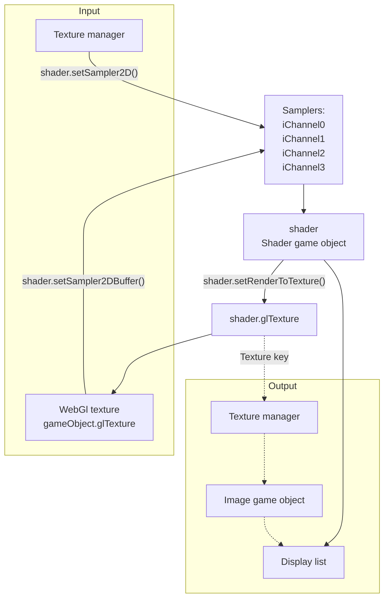

# 着色器 {#page-title}

Phaser 4 指南 · [英文原文](https://phaser.io/oss/docs/phaser/concepts/gameobjects/shader)

此游戏对象允许您在显示列表中轻松添加带有自身遮蔽器的四重奏,并像您一样操纵它,包括缩放,旋转,定位和添加到容器中. 阴影可以被比特玛普或几何口罩遮盖,也可以作为相机或其他游戏对象的比特玛普面具,也可以被交互并用于输入事件.

它通过引用一个 `Phaser.Display.BaseShader` 实例来工作, 其实例见于 Shader 缓存。 这些可以在运行时动态创建, 或者通过 GLSL 文件加载器加载 :

```js
function preload ()
{
    this.load.glsl('fire', 'shaders/fire.glsl.js');
}

function create ()
{
    this.add.shader('fire', 400, 300, 512, 512);
}
```

请参看Phaser 3 实例 GitHub repo , 以动态方式加载和创建着色器的例子 。

由于其工作方式, 您无法直接改变阴影的α或混合模式。 应通过阴影码本身的曝光制服处理 。

默认情况下, 将创建一套标准制服的阴影。 这些制服是添加到ShaderToy 或 GLSandbox 等站点的, 并提供遮蔽器可能需要的通用功能, 如时间戳、 分辨率或指针位置。 您可以在 Base Shader 指定自己的制服来替换它们 。

这些阴影通过在渲染过程中停止当前管道的工作,创建一个与此游戏对象大小相匹配的视图,然后使用绑定的着色器使一个四进制。 最终, 管道被恢复 。

因为它会阻断管道,所以它会中断任何正在进行中的批量,所以你应该节制使用这些游戏对象。如果需要一个完整的批量自定义遮阳器,请查看使用自定义管道。但是,对于背景效果或特殊遮阳效果,它们非常有效。

## 装入 GLSL {#load-glsl}

```javascript
this.load.glsl(key, url);
```

参考文献: [load glsl](/guide/concepts/loader#glsl)

## 添加阴影对象 {#add-shader-object}

```javascript
var shader = this.add.shader(key, x, y, width, height, textures);
```

- `key`:从*shader缓存* 或一个 [BaseShader instance](#baseshader) 中用到的遮荫器的密钥.
- `x`, `y` : 位置。
- `width`, `height` : 大小( 缩写).
- `textures` : 用于绑定到 iChannel0, iChannel1, iChannel2, iChannel3 制服,你穿的怎么样?

!!! note
    许多遮蔽器预计纹理是**2个大小的功率**.

从 JSON 添加阴影对象

```javascript
var shader = this.make.shader({
    x: 0,
    y: 0,
    key: '',

    // angle: 0,
    // alpha: 1
    // flipX: true,
    // flipY: true,
    // scale : {
    //    x: 1,
    //    y: 1
    //},
    // origin: {x: 0.5, y: 0.5},

    add: true
});
```

- `key`:从遮荫缓存中使用的遮荫器的密钥,或 BaseShader 实例.
  - 字符串
  - 随机选择一个元素的字符串阵列
- `x`, `y`, `scale.x`, `scale.y` :
  - 数字
  - 回调以获取返回值

    ```javascript
    function() { return 0; }
    ```

  - 分钟和最大值之间的随机整数

    ```javascript
    { randInt: [min, max] }
    ```

  - 分钟到最大值之间随机浮点数

    ```javascript
    { randFloat: [min, max] }
    ```

## 自定义类 {#custom-class}

- 定义类

    ```javascript
    class MyShader extends Phaser.GameObjects.Shader {
        constructor(scene, key, x, y, width, height, textures) {
            super(scene, key, x, y, width, height, textures);
            // ...
            this.add.existing(this);
        }
        // ...

        // preUpdate(time, delta) {}
    }
    ```

  - `this.add.existing(gameObject)`: 将已有的游戏对象添加到此场景中.
    - 如果游戏对象使它成为了,它会被添加到显示列表中.
    - 如果它有`preUpdate`方法,它将被添加到更新列表中.
- 创建实例

    ```javascript
    var shader = new MyShader(scene, key, x, y, width, height, textures);
    ```

## 标本2D 制服 {#sampler2d-uniform}

- 默认的统一映射 :
  - `resolution`(2f) - 设定为此遮蔽器的大小 。
    - `uniform vec2 resolution;` in GLSL.
  - `time`(1f) - 游戏时间过长,以秒计.
    - `uniform float time;` in GLSL.
  - `mouse`(2f) - 如果一个指针已经绑定(带有`setPointer`),这个制服包含每个帧的位置.
    - `uniform vec2 mouse;` in GLSL.
  - `date`(4fv) - 含有年份,月份,日,时间的vec4,以秒计.
    - `uniform vec4 date;` in GLSL.
  - `sampleRate`(1f) - 声音样本率. 44100默认.
    - `uniform float sampleRate;` in GLSL.
  - `iChannel0...3`(sampler2D) - 默认输入频道0至3. `null`.
        `uniform sampler2D iChannel0;` in GLSL.
- 获取统一对象

    ```javascript
    var uniform = shader.getUniform(key);
    ```

  - 纹理密钥

    ```javascript
    var textureKey = uniform.textureKey;
    ```

  - 获得`iChannel0`的纹理密钥,`iChannel1`,`iChannel2`,`iChannel3`采样机2D制服.

    ```javascript
    var textureKey = shader.getUniform('iChannel0').textureKey;
    var textureKey = shader.getUniform('iChannel1').textureKey;
    var textureKey = shader.getUniform('iChannel2').textureKey;
    var textureKey = shader.getUniform('iChannel3').textureKey;
    ```

- 设置此阴影上已经存在的制服属性 。

    ```javascript
    shader.setUniform(key, value);
    ```

  - `key`: 修改制服的密钥, 深属性使用点, 即 `resolution.value.x` 。
- 从纹理管理器中设置一个采样器2D制服.

    ```javascript
    shader.setChannel0(textureKey);
    shader.setChannel1(textureKey);
    shader.setChannel2(textureKey);
    shader.setChannel3(textureKey);
    // shader.setChannel0(textureKey, textureData);
    // shader.setChannel1(textureKey, textureData);
    // shader.setChannel2(textureKey, textureData);
    // shader.setChannel3(textureKey, textureData);
    ```

    or

    ```javascript
    shader.setSampler2D(uniformKey, textureKey, textureIndex);
    // shader.setSampler2D(uniformKey, textureKey, textureIndex, textureData);
    ```

  - `uniformKey` : `'iChannel0'`, `'iChannel1'`, `'iChannel2'`,或 ,或 , `'iChannel3'`.
  - `textureIndex` : `0`(单位:千美元) iChannel0), `1`(单位:千美元) iChannel1), `2`(单位:千美元) iChannel2), `3`(单位:千美元) iChannel3).
  - `textureData` : 额外的纹理数据.
  - `textureKey`: 纹理管理器缓存的密钥。 它不能是纹理的单个框架, 只包含完整的图像。 许多遮蔽器预计纹理是** 2 个大小的** 。
- 设置一个网格纹理的采样器2D制服。

    ```javascript
    shader.setSampler2DBuffer(uniformKey, texture, width, height, textureIndex);
    // shader.setSampler2DBuffer(uniformKey, texture, width, height, textureIndex, textureData);
    ```

  - `uniformKey` : `'iChannel0'`, `'iChannel1'`, `'iChannel2'`,或 ,或 , `'iChannel3'`.
  - `width`, `height` :宽度,纹理高度.
  - `textureIndex` : `0`(单位:千美元) iChannel0), `1`(单位:千美元) iChannel1), `2`(单位:千美元) iChannel2), `3`(单位:千美元) iChannel3).
  - `textureData` : 额外的纹理数据.

## 其他制服 {#other-uniforms}

- `mouse`,一个指针参数.
  - Get

    ```javascript
    var pointer = shader.pointer;
    ```

  - Set

    ```javascript
    shader.setPointer(pointer);
    ```

    - `pointer` : `{x, y}`
- `time`, 游戏时间已过, 以 *秒* 计.
  - Get

    ```javascript
    var time = shader.getUniform('time').value;
    // var time = shader.uniforms.time.value
    ```

  - Set

    ```javascript
    shader.setUniform('time.value', time);
    ```

## 产出 {#output}

- 默认情况下, 将显示列表 。
- 重定向生成内部的网格纹理 。

    ```javascript
    shader.setRenderToTexture();
    var texture = shader.glTexture;
    ```

- 将结果重定向到内部的webgl纹理,以及缓冲器的样本2D.

    ```javascript
    shader.setRenderToTexture(undefined, true);
    var texture = shader.glTexture;
    ```

- 重定向渲染结果给纹理管理器,用于基于纹理的游戏对象.

    ```javascript
    shader.setRenderToTexture(textureKey);
    // var texture = shader.glTexture;
    ```

- 重定向向纹理管理器和缓冲器的Sample2D 生成结果 。

    ```javascript
    shader.setRenderToTexture(textureKey, true);
    // var texture = shader.glTexture;
    ```

## 纹理路由 {#texture-routing}



## 其他属性 {#other-properties}

见[game object](/guide/concepts/gameobjects)

## 创建遮罩 {#create-mask}

```javascript
var mask = shader.createBitmapMask();
```

见[mask](/guide/concepts/display#masks)

## 基片包 {#baseshader}

```javascript
var baseShader = new Phaser.Display.BaseShader(key, fragmentSrc, vertexSrc, uniforms);
```

- `key` : 此阴影的密钥
- `fragmentSrc` : 遮阳器的碎片源.
- `vertexSrc` : 遮荫者顶部源.
  - `undefined`,或称`''`:使用默认顶点源.
- `uniforms`:可选对象定义遮阳器使用的制服.

    ```javascript
    {
        uniformName : {type: uniformType, value: initValue},
        ...
    }
    ```

  - `uniformName`: 碎片源中的统一名称.
  - `uniformType`,`initValue`:统一型的型号和初始值.
    - `'1f'`:`initValue`是一个单一浮点值.
      - 示例: `time: { type: '1f', value: 0 }`
    - `'2f'`:`initValue`是浮标编号`{x, y}`.
      - 示例: `resolution: { type: '2f', value: { x: this.width, y: this.height } }`
    - `'3f'`:`initValue`是浮标编号`{x, y, z}`.
      - 示例: `color: { type: '3f', value: {x: 0, y: 0, z: 0}}`
    - `'4f'`:`initValue`是浮标编号`{x, y, z, w}`.

## 作者的信用额度 {#author-credits}

本页的内容包括下列工作:

- [RexRainbow](https://github.com/rexrainbow)

---
