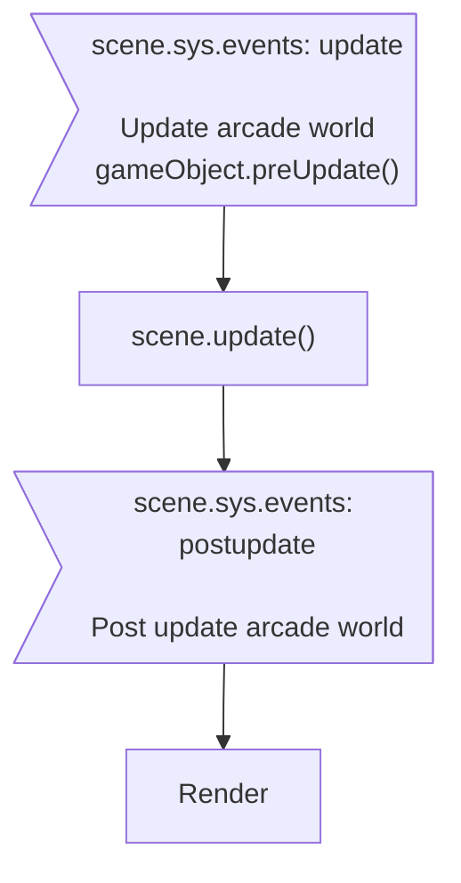

# Arcade 物理 {#page-title}

Phaser 4 指南 · [英文原文](https://phaser.io/oss/docs/phaser/concepts/physics/arcade)

弧形物理(Arcade Physics),其名称的意思是,它指的更是"arcade"或"retro"风格的游戏,虽然它并不限于那些游戏,它是一个轻量级的物理系统,只能处理两种不同类型的物理形状:矩形和圆形,它不是用于复杂的物理模拟,而是用于平台,自上而下游戏,或谜题游戏等简单事物,它使用速度非常快,容易,具有许多帮助者功能,但由于其性质,它确实有其局限性.

弧形物理必须启用后才能使用。 可以通过游戏配置或每场进行。 一旦启用, 您可以在游戏中添加物理功能的游戏对象。 这将允许您使用内置物理功能控制螺旋, 如速度、 加速、 重力等 。

默认情况下, 无法为物理启用游戏对象。 这是因为并非所有游戏对象都需要。 例如, 背景图像或游戏标志可能不需要受到物理影响, 而玩家字符需要。 因此, 您必须启用您特别希望受其影响的游戏对象上的物理。 我们将在后面章节中详细论述这个问题 。

弧形物理和物质物理是两个独立的系统。例如,弧形物理图案不能与物质物理图案相撞。不能在两个系统上添加相同的Sprite,你需要选择一个或另一个。尽管这样做是不寻常的,但这两个系统实际上可以在同一场景中平行运行。这意味着可以有一个使用Arcade物理的Sprite和一个使用物质物理的Sprite,它们将同时工作,尽管它们不会一起互动。

## 街机世界协会 {#arcade-world}

弧形物理世界是所有物理相互作用在弧形物理系统内部发生的环境,它管理物体运动,碰撞和各种力量反应的模拟. 弧形物理世界跟踪它内部的所有物体(称为"天体"),处理它们的物理相互作用,并随时间推移更新它们的位置和速度.

### 配置 {#configuration}

弧形物理`config`对象定义了全球的弧形物理系统的行为.

- 基本配置对象

```js
const config = {
    // ...
    physics: {
        default: 'arcade'
    },
    // ...
};

const game = new Phaser.Game(config);
```

- 完整配置

```js
const config = {
  // ...
  physics: {
    default: "arcade",
    arcade: {
      //    x: 0,
      //    y: 0,
      //    width: scene.sys.scale.width,
      //    height: scene.sys.scale.height,
      //    gravity: {
      //        x: 0,
      //        y: 0
      //    },
      //    checkCollision: {
      //        up: true,
      //        down: true,
      //        left: true,
      //        right: true
      //    },
      //    customUpdate: false,
      //    fixedStep: true,
      //    fps: 60,
      //    timeScale: 1,     // 2.0 = half speed, 0.5 = double speed
      //    customUpdate: false,
      //    overlapBias: 4,
      //    tileBias: 16,
      //    forceX: false,
      //    isPaused: false,
      //    debug: false,
      //    debugShowBody: true,
      //    debugShowStaticBody: true,
      //    debugShowVelocity: true,
      //    debugBodyColor: 0xff00ff,
      //    debugStaticBodyColor: 0x0000ff,
      //    debugVelocityColor: 0x00ff00,
      //    maxEntries: 16,
      //    useTree: true   // set false if amount of dynamic bodies > 5000
    },
  },
  // ...
};
const game = new Phaser.Game(config);
```

### 更新 {#update}

- 默认更新: 世界更新每勾选
- 自定义更新 :

  1. 设定街机配置的`customUpdate`到`false`.
     - 启用世界更新 : `this.physics.enableUpdate()`
     - 禁用世界更新 : `this.physics.disableUpdate()`
  2. 手动运行世界更新

     ```js
     this.physics.world.update(time, delta);
     ```

  3. 启用/ 残疾世界更新
     - 启用 : `this.physics.enableUpdate()`
     - 禁用: `this.physics.disableUpdate()`

#### 步骤 {#step}

- 一步一步推进模拟.

  ```js
  this.physics.world.singleStep();
  ```

- 以时间递增的方式推进模拟。

  ```js
  this.physics.world.step(delta);
  ```

### 控制器 {#control}

#### 暂停 {#pause}

```js
this.physics.pause();
```

#### 继续 {#resume}

```js
this.physics.resume();
```

#### 每个框架的持续时间 {#duration-per-frame}

- 时间尺度

  ```js
  this.physics.world.timeScale = timeScale;
  ```

  - 1.0=正常速度
  - 2.0 = 半速 = 半速 = 半速 = 半速 = 半速 = 半速 = 半速 = 半速 = 半速 = 半速 = 半速 = 半速 = 半速 = 半速 = 半速 = 半速 = 半速 = 半速 = 半速 = 半速 = 半速 = 半速 = 半速 = 半速 = 半速 = 半速 = 半速 = 半速 = 半速 = = 半速 = = 半速 = = 半速 = = 半速 = = 半速 = = = = = 半速 = = = = = = = = = = = = = = = = = = = = = = = = = = = = = = = = = = = = = = = = = = = = = = = = = = = = = = = = = = = = = = = = = = = = = = = = = = = = = = = = = = = = = = = = = = = = = = = = = = = = = = = = = = = = = = = = = = = = = = = = = = = = = = =
  - 0.5=双倍速

- 每秒框架(FPS)

  ```js
  this.physics.world.setFPS(framerate);
  ```

#### 拖动过滤选项 {#tile-filter-options}

```js
var option = this.physics.world.tileFilterOptions;
```

- `option`

  ```js
  {
      isColliding: true,
      isNotEmpty: true,
      hasInterestingFace: true
  }
  ```

### 体质 {#body}

#### 启用 {#enable}

```js
this.physics.world.enable(gameObject);
// this.physics.world.enable(gameObject, bodyType);
```

- `gameObject`:一个游戏对象,或游戏对象的阵列,或游戏对象在`Group`中.
- `bodyType` :
  - `0` : 动态正体。默认值。
  - `1` :静体.

Or

```js
this.physics.add.existing(gameObject, bodyType);
```

见[arcade-body](#get-physics-body)

#### 禁用 {#disable}

```js
this.physics.world.disable(gameObject);
```

- `gameObject`:一个游戏对象,或游戏对象的阵列,或游戏对象在`Group`中.

#### 添加/移动正文 {#addremove-body}

- 加入身体到本地的搜索树上。

  ```js
  this.physics.world.add(body);
  ```

- 从本地搜索树上移除尸体 。

  ```js
  this.physics.world.disableBody(body);
  ```

### 碰撞 {#collision}

#### 设定约束 {#set-bound}

以[body object](#body-collision-bounds)或[game object](#game-object-collision-bounds)表示绑定.

#### 对抗器回调( C) {#collider-callback}

- 添加对撞机

  - 推出来

    ```js
    this.physics.add.collider(objectsA, objectsB);
    ```

  - 进行两个物理允许对象之间的碰撞检查和分离。

    ```js
    var collider = this.physics.add.collider(
      objectsA,
      objectsB,
      collideCallback
    );
    // var collider = this.physics.add.collider(objectsA, objectsB, collideCallback, processCallback, callbackContext);
    ```

  - 如果你不需要分离,那么用`overlap`代替.

    ```js
    var collider = this.physics.add.overlap(
      objectsA,
      objectsB,
      collideCallback
    );
    // var collider = this.physics.add.overlap(objectsA, objectsB, collideCallback, processCallback, callbackContext);
    ```

  - 参数

    - `objectsA`, `objectsB` :
      - 游戏对象
      - 阵列包含 Game 对象( 添加或删除游戏对象)
      - 物理组/ 组( 添加或删除游戏对象)
      - 一个阵列包含物理组/ 组
    - `collideCallback` :

      ```js
      var collideCallback = function (gameObject1, gameObject2) {
        // ...
      };
      ```

    - `processCallback` : 当 gameObject1 交叉 gameObject2,可选。

      ```js
      var processCallback = function (gameObject1, gameObject2) {
        return true; // return false will discard remaining collision checking
      };
      ```

- 删除对撞机

  ```js
  this.physics.world.removeCollider(collider);
  ```

- 解除对撞机

  ```js
  collider.active = false; // Set true to activate again
  ```

- 相撞器名称( 引擎未使用)

  ```js
  collider.name = name;
  ```

#### 测试不发生碰撞 {#testing-without-colliders}

- 测试重叠

  ```js
  var isOverlapping = this.physics.world.overlap(object1, object2);
  ```

  or

  ```js
  var isOverlapping = this.physics.world.overlap(
    object1,
    object2,
    collideCallback
  );
  // var isOverlapping = this.physics.world.overlap(object1, object2, collideCallback, processCallback, callbackContext);
  ```

- 测试碰撞, 也推出去

  ```js
  var isCollided = this.physics.world.collide(object1, object2);
  ```

  or

  ```js
  var isCollided = this.physics.world.collide(
    object1,
    object2,
    collideCallback
  );
  // var isCollided = this.physics.world.collide(object1, object2, collideCallback, processCallback, callbackContext);
  ```

- 车身与瓦片重叠,其`onOverlap`属性设定为`true`.

  ```js
  this.physics.world.on("tileoverlap", function (gameObject, tile, body) {
    /* ... */
  });
  ```

- 车身与瓦片重叠,其`onCollide`属性设定为`true`.

  ```js
  this.physics.world.on("tilecollide", function (gameObject, tile, body) {
    /* ... */
  });
  ```

### 街机世界界限 {#arcade-world-bounds}

#### 启用 {#enable-1}

- [Body](#arcade-body) 设置 `body.setCollideWorldBounds()` 启用 worldBounds 属性。
- World :

  - 设定边框 [rectangle](/guide/concepts/geometry#rectangle) 并启用边框

    ```js
    this.physics.world.setBounds(x, y, width, height);
    // this.physics.world.setBounds(x, y, width, height, checkLeft, checkRight, checkUp, checkDown);
    ```

  - 设定边界 [rectangle](/guide/concepts/geometry#rectangle)

    ```js
    this.physics.world.bounds.setTo(x, y, width, height);
    ```

    or

    ```js
    this.physics.world.bounds.x = x;
    this.physics.world.bounds.y = y;
    this.physics.world.bounds.width = width;
    this.physics.world.bounds.height = height;
    ```

  - 启用边框

    ```js
    this.physics.world.setBoundsCollision();
    // this.physics.world.setBoundsCollision(left, right, up, down);
    ```

    or

    ```js
    this.physics.world.checkCollision.left = left;
    this.physics.world.checkCollision.right = right;
    this.physics.world.checkCollision.up = up;
    this.physics.world.checkCollision.down = down;
    ```

  - 获得边框 [rectangle](/guide/concepts/geometry#rectangle)

    ```js
    var top = this.physics.world.bounds.top;
    var bottom = this.physics.world.bounds.bottom;
    var left = this.physics.world.bounds.left;
    var right = this.physics.world.bounds.right;
    ```

### 区域内的尸体 {#bodies-inside-an-area}

- 重叠矩形区域

  ```js
  var bodies = this.physics.overlapRect(
    x,
    y,
    width,
    height,
    includeDynamic,
    includeStatic
  );
  ```

  - `includeDynamic`: 设置`true`以搜索动态天体
  - `includeStatic` 设置 `true` 搜索静态天体

- 重叠一个圆形区域

  ```js
  var bodies = this.physics.overlapCirc(
    x,
    y,
    radius,
    includeDynamic,
    includeStatic
  );
  ```

  - `includeDynamic`: 设置`true`以搜索动态天体
  - `includeStatic` 设置 `true` 搜索静态天体

### 环绕 {#wrap}

```js
this.physics.world.wrap(gameObject, padding);
```

- gameObject:
  - 游戏对象
  - group
  - 游戏对象阵列

### 移动到 {#move-to}

- 以稳定的速度移动到位置

  ```js
  this.physics.moveTo(gameObject, x, y, speed, maxTime);
  ```

- 移动到有稳定速度的天体

  ```js
  this.physics.moveToObject(gameObject, destination, speed, maxTime);
  ```

### 加速至 {#accelerate-to}

- 加速到位置

  ```js
  this.physics.accelerateTo(
    gameObject,
    x,
    y,
    acceleration,
    xSpeedMax,
    ySpeedMax
  );
  ```

- 加速到对象

  ```js
  this.physics.accelerateToObject(
    gameObject,
    destination,
    acceleration,
    xSpeedMax,
    ySpeedMax
  );
  ```

### 重力 {#gravity}

- Set

  ```js
  this.physics.world.gravity.x = gx;
  this.physics.world.gravity.y = gy;
  ```

- Get

  ```js
  var gx = this.physics.world.gravity.x;
  var gy = this.physics.world.gravity.y;
  ```

引力总值=世界. 引力+体. 引力

### 机构 {#bodies}

#### 关闭/装修 {#closestfurthest}

- Closest

  ```js
  var body = this.physics.closest(point); // point: {x,y}
  // var body = this.physics.closest(point, targets);
  ```

  - `targets`: Arcade物理游戏对象,身体或静态体的阵列.

- Furthest

  ```js
  var body = this.physics.furthest(point); // point: {x,y}
  // var body = this.physics.furthest(point, targets);
  ```

  - `targets`: Arcade物理游戏对象,身体或静态体的阵列.

### 调试 {#debug}

#### 绘制正文速度( F) {#draw-body-velocity}

- 动态体的界限

  - 启用绘图正文

    ```js
    this.physics.world.defaults.debugShowBody = true;
    ```

  - Color

    ```js
    this.physics.world.defaults.bodyDebugColor = 0xff00ff;
    ```

- 静态体的边界

  - 启用绘图正文

    ```js
    this.physics.world.defaults.debugShowStaticBody = true;
    ```

  - Color

    ```js
    this.physics.world.defaults.staticBodyDebugColor = 0x0000ff;
    ```

- 速度的方向和规模

  - 启用绘图正文

    ```js
    this.physics.world.defaults.debugShowVelocity = true;
    ```

  - Color

    ```js
    this.physics.world.defaults.velocityDebugColor = 0x00ff00;
    ```

#### 图形 {#graphics}

在 [Graphics object](/guide/concepts/gameobjects/graphics) 上绘制调试机身和调试速度 。

```js
var graphics = this.physics.world.debugGraphic;
```

- 设定可见

  ```js
  this.physics.world.debugGraphic.setVisible();
  ```

- 设置隐形

  ```js
  this.physics.world.debugGraphic.setVisible(false);
  ```

### 事件 {#events}

- 世界步骤

  ```js
  this.physics.world.on("worldstep", function (delta) {
    /* ... */
  });
  ```

  - `delta` :这个步骤的三角洲时间量,以秒计.

- 暂停世界

  ```js
  this.physics.world.on("pause", function () {
    /* ... */
  });
  ```

- 恢复世界 维基百科中的相关条目: 维基语录链接:名人名言 - 文学作品 - 谚语 - 谚语 - 谚语 - 谚语 - 谚语 - 谚语 - 谚语 - 谚语 - 谚语

  ```js
  this.physics.world.on("resume", function () {
    /* ... */
  });
  ```

- 两具尸体重叠,其中至少有一具有他们的`onOverlap`财产被设定为`true`.

  ```js
  this.physics.world.on(
    "overlap",
    function (gameObject1, gameObject2, body1, body2) {
      /* ... */
    }
  );
  ```

- 两具尸体重叠,其中至少有一具有他们的`onCollide`财产被设定为`true`.

  ```js
  this.physics.world.on(
    "collide",
    function (gameObject1, gameObject2, body1, body2) {
      /* ... */
    }
  );
  ```

- 车身与瓦片重叠,其`onOverlap`属性设定为`true`.

  ```js
  this.physics.world.on("tileoverlap", function (gameObject, tile, body) {
    /* ... */
  });
  ```

- 车身与瓦片重叠,其`onCollide`属性设定为`true`.

  ```js
  this.physics.world.on("tilecollide", function (gameObject, tile, body) {
    /* ... */
  });
  ```

- 世界界限

  ```js
  this.physics.world.on(
    "worldbounds",
    function (body, blockedUp, blockedDown, blockedLeft, blockedRight) {
      /* ... */
    }
  );
  ```

### 更新环路 {#update-loop}

1. 场景. sys.events:更新
   1. 更新每个天体的位置角度( R)
   1. 每个对撞机处理
   1. 更新每个机构的最后立场
   1. 释放 `worldstep` 事件
1. 现场.sys.events: 后期
   1. 绘制调试图形



## 拱门正体 {#arcade-body}

弧形物理体与游戏对象相关联,并管理其物理属性和行为.

### 使用量 {#usage}

#### 获得物理体 {#get-physics-body}

1. [Enable physics world](#configuration)
1. 将已有的游戏对象添加到物理世界
   - 添加游戏对象

     ```js
     var gameObject = this.physics.add.existing(gameObject, bodyType);
     ```

     - `bodyType` :
       - `0`: 动态正体
       - `1` : 静态体
   - 添加游戏对象

     ```js
     this.physics.world.enable(gameObjects, bodyType);
     ```

     - `gameObjects`: 游戏对象的阵列, 或组合对象
     - `bodyType` :
       - `0`: 动态正体
       - `1` : 静态体
1. 获得物理体

   ```js
   var body = gameObject.body;
   ```

#### 启用和禁用 {#enable-and-disable}

此天体是否通过物理模拟更新 。

- 启用( 默认)

  ```js
  body.setEnable();
  ```

  or

  ```js
  body.enable = true;
  ```

- Disable

  ```js
  body.setEnable(false);
  ```

  or

  ```js
  body.enable = false;
  ```

#### 直接控制 {#direct-control}

当游戏对象被 tween 或拖曳控制时启用 `directControl`。 默认行为已禁用 。

- Enable

  ```js
  body.setDirectControl(); // default argument is true
  // body.setDirectControl(true);
  ```

  or

  ```js
  body.directControl = true;
  ```

- Disable

  ```js
  body.setDirectControl(false);
  ```

  or

  ```js
  body.directControl = false;
  ```

#### 不可移动 {#immovable}

是否可以通过与另一个天体的碰撞来移动此天体 。

- Enable

  ```js
  body.setImmovable();
  // body.immovable = true;
  ```

- 禁用( 取消)

  ```js
  body.setImmovable(false);
  // body.immovable = false;
  ```

- Get

  ```js
  var immovable = body.immovable;
  ```

#### 可推车 {#pushable}

如果此天体能被另一个天体推动, 则设定 。

- 启用( 动态正体的默认值)

  ```js
  body.pushable = true;
  ```

- 禁用,反射它给碰撞体的所有速度。

  ```js
  body.pushable = false;
  ```

- Get

  ```js
  var pushable = body.pushable;
  ```

#### 可移动 {#moveable}

机体的位置和旋转是否受到其速度,加速度,拖动和重力的影响.

- 启用( 默认)

  ```js
  body.moves = true;
  ```

- Disable

  ```js
  body.moves = false;
  ```

- Get

  ```js
  var moves = body.moves;
  ```

#### 摧毁 {#destroy}

物理体在游戏对象被破坏时会自动被销毁.

#### 移动 {#movement}

##### 速度 {#velocity}

- Set

  ```js
  body.setVelocity(x, y);
  ```

  or

  ```js
  body.setVelocityX(x);
  body.setVelocityY(x);
  ```

- Get

  ```js
  var vx = body.velocity.x;
  var vy = body.velocity.y;
  ```

##### 最大速度 {#max-speed}

- Set

  ```js
  body.setMaxSpeed(speed);
  ```

- Get

  ```js
  var speed = body.maxSpeed;
  ```

##### 最大速度( T) {#max-velocity}

- Set

  ```js
  body.setMaxVelocity(x, y);
  ```

  or

  ```js
  body.setMaxVelocityX(x);
  body.setMaxVelocityY(y);
  ```

- Get

  ```js
  var vx = body.maxVelocity.x;
  var vy = body.maxVelocity.y;
  ```

##### 加速 {#acceleration}

- Set

  ```js
  body.setAcceleration(x, y);
  ```

  or

  ```js
  body.setAccelerationX(x);
  body.setAccelerationY(y);
  ```

- Get

  ```js
  var ax = body.acceleration.x;
  var ay = body.acceleration.y;
  ```

##### 重力 {#gravity-1}

- Set

  ```js
  body.setGravity(x, y);
  ```

  or

  ```js
  body.setGravityX(x);
  body.setGravityY(y);
  ```

- Get

  ```js
  var gx = body.gravity.x;
  var gy = body.gravity.y;
  ```

- 启用( 默认)

  ```js
  body.setAllowGravity();
  ```

- Disable

  ```js
  body.setAllowGravity(false);
  ```

##### 拖动 {#drag}

减速每秒。

- Set

  ```js
  body.setDrag(x, y);
  ```

  or

  ```js
  body.setDragX(x);
  body.setDragY(y);
  ```

- Get

  ```js
  var dx = body.drag.x;
  var dy = body.drag.y;
  ```

- 启用( 默认)

  ```js
  body.setAllowDrag();
  ```

- Disable

  ```js
  body.setAllowDrag(false);
  ```

- 启用达标( 默认: 禁用)

  ```js
  body.setDamping(true);
  // body.useDamping = true;
  ```

##### 幻灯片因数 {#slide-factor}

幻灯片因子控制当此天体被另一个天体推动时,其速度被保存多少 。

```js
body.slideFactor.set(x, y);
```

- `x`, `y` :
  - `1` : 使用推力中给出的所有速度。 默认值 。
  - `0` :允许这个机构被推,但之后在推结束后完全保持静止,
    就像你看到的游戏 像_Sokoban_。
  - `0`~`1`之间的其他值:在推力结束时保持原速的`x`/`y`.
    - 将此与`setDrag()`方法结合,以创建减速.

##### 重设位置 {#reset-position}

```js
body.reset(x, y);
```

##### 停下来 {#stop}

设置加速,速度,速度为0.

```js
body.stop();
```

###### 闪光灯 {#friction}

如果这个机身是`immovable`,并且正在运动,这就是这个机身在每根轴上被骑机体得到的动作比例.

- Set

  ```js
  body.setFriction(x, y);
  ```

  or

  ```js
  body.setFrictionX(x);
  body.setFrictionY(y);
  ```

- Get

  ```js
  var fx = body.friction.x;
  var fy = body.friction.y;
  ```

##### 速度 {#speed}

- 本体水平/垂直位置的绝对(非负)变化与前一步相比.

  ```js
  var dx = body.deltaAbsX();
  var dy = body.deltaAbsY();
  ```

#### 旋转 {#rotation}

##### 允许旋转 {#allow-rotation}

是否受它的角加速和速度影响此天体的旋转.

- 启用( 默认)

  ```js
  body.setAllowRotation();
  ```

- Disable

  ```js
  body.setAllowRotation(false);
  ```

- Get

  ```js
  var allowRotation = body.allowRotation;
  ```

##### 角速度 {#angular-velocity}

- Set

  ```js
  body.setAngularVelocity(v);
  ```

- Get

  ```js
  var av = body.angularVelocity;
  ```

##### 角加速 {#angular-acceleration}

- Set

  ```js
  body.setAngularAcceleration(v);
  ```

- Get

  ```js
  var aa = body.angularAcceleration;
  ```

##### 角拖动 {#angular-drag}

降低角速度每秒。

- Set

  ```js
  body.setAngularDrag(v);
  ```

- Get

  ```js
  var ad = body.angularDrag;
  ```

#### 碰撞 {#collision-1}

##### 碰撞类别 {#collision-category}

默认情况下, 所有天体都与其他天体碰撞。 碰撞类定义了不同物理天体在碰撞过程中的相互作用, 它指定了哪些天体应当碰撞,哪些天体不应当碰撞。 碰撞类通常使用一个位图设定, 每个类别由两个的独特力量来代表。 天体可以与多个碰撞类别相碰撞 。

- 碰撞类别
  - Get

    ```js
    var collisionCategory = body.collisionCategory;
    ```

  - Set

    ```js
    body.setCollisionCategory(category);
    ```

    - `category` :
      - `(1 << 0)`
      - `(1 << 1)`
      - `(1 << 2)`
      - ...
      - `(1 << 31)`
  - 重置碰撞类别, 到默认行为( 所有天体与所有其他天体碰撞)

    ```js
    body.resetCollisionCategory();
    ```

    - 将`collisionCategory`设定为`1`.
    - 将 `collisionMask` 设定为 `1`
- 碰撞掩体
  - Get

    ```js
    var collisionMask = body.collisionMask;
    ```

  - Set

    ```js
    body.setCollidesWith(categories);
    ```

    - `categories`:一个单一的类别值,或其中的数组.
  - Add

    ```js
    body.addCollidesWith(category):
    ```

    - `category`:一个单一类别值.
  - Remove

    ```js
    body.removeCollidesWith(category);
    ```

    - `category`:一个单一类别值.

##### 车体碰撞界限 {#body-collision-bounds}

碰撞界限定义了用于碰撞探测的区域.

- Rectangle

  ```js
  body.setSize(width, height, center);
  ```

  - `center` : `false` 将机身的乘以(0,0)
    - 无法在[Graphics](/guide/concepts/gameobjects/graphics)对象中工作.
- Circle

  ```js
  body.setCircle(radius, offsetX, offsetY);
  ```

##### 碰撞偏移 {#collision-offset}

调整物理天体碰撞相对于图示的位置。当图示视觉与碰撞区域不相匹配时使用。

```js
body.setOffset(x, y);
```

##### 推出来 {#push-out}

进行两个物理允许对象之间的碰撞检查和分离。

```js
this.physics.add.collider(objectsA, objectsB);
```

- `objectsA`, `objectsB` :
  - 游戏对象
  - 阵列中的游戏对象( 添加或删除游戏对象)
  - 物理组( 添加或删除游戏对象)
  - 分组( 添加或删除游戏对象)

##### 回拨 {#callbacks}

回调是每个步骤在两个对象之间发生碰撞或重叠时调用的函数.

```js
var collider = this.physics.add.collider(objectsA, objectsB, collideCallback, processCallback, callbackContext);
```

- `collideCallback` : 当两个对象碰撞时, 需要引用的调值 。
- `processCallback`: 当两个对象碰撞时, 调用。 必须返回布尔 。
- `callbackContext` : 调用回调的范围.

##### 指向内侧 {#point-inside}

`hitTest`功能检查游戏世界中是否有特定的点与任何物理天体相撞,如果发生碰撞则返回`true`,否则返回`false`.

```js
var hit = body.hitTest(x, y);
```

##### 正在碰撞中 {#is-colliding}

- 正在碰撞这个勾选和哪个方向

  ```js
  var isColliding = body.touching;
  ```

  - `isColliding` :

    ```js
    {
        none: true,
        up: true,
        down: true,
        left: true,
        right: true
    }
    ```

- 碰撞体在前一步的感人价值.

  ```js
  var wasColliding = body.wasTouching;
  ```

  - `wasColliding` :

    ```js
    {
        none: true,
        up: true,
        down: true,
        left: true,
        right: true
    }
    ```

##### 弹跳 {#bounce}

定义身体在与另一个物体碰撞后如何反弹。弹跳值通常在0到1. 0之间,使身体停止弹跳,并在碰撞时停止。1 使身体以碰撞前的同样速度反弹。大于1 值会提高碰撞后的体速。

- Set

  ```js
  body.setBounce(x, y);
  ```

  or

  ```js
  body.setBounceX(x); // horizontal bounce
  body.setBounceY(y); // vertical bounce
  ```

- Get

  ```js
  var bx = body.bounce.x;
  var by = body.bounce.y;
  ```

##### 身体世界界限 {#body-world-bounds}

- [Default world bounds](#arcade-world-bounds)
- 自定义世界界限 :

  ```js
  body.setBoundsRectangle(bounds);
  ```

  - `bounds` 资源: [rectangle object](/api/class/geom-rectangle).
- Enable

  ```js
  body.setCollideWorldBounds();
  ```

- 禁用( 默认)

  ```js
  body.setCollideWorldBounds(false);
  ```

- 获得世界边界 [rectangle](/guide/concepts/geometry#rectangle)

  ```js
  var top = body.world.bounds.top;
  var bottom = body.world.bounds.bottom;
  var left = body.world.bounds.left;
  var right = body.world.bounds.right;
  ```

##### 已封禁 {#blocked}

检查此天体是否与瓦片相撞, 或是世界边界 。

- 下移时被屏蔽

  ```js
  var onFloor = body.onFloor();
  // var onFloor = body.blocked.down
  ```

- 向上移动时被封禁

  ```js
  var onCeiling = body.onCeiling();
  // var onCeiling = body.blocked.up
  ```

- 左或右移动时被屏蔽

  ```js
  var onWall = body.onWall();
  // var onLeftWall = body.blocked.left
  // var onRightWall = body.blocked.right
  ```

- State

  ```js
  var blocked = body.blocked;
  ```

  - `blocked` :

    ```js
    {
        none: true,
        up: false,
        down: false,
        left: false,
        right: false
    }
    ```

#### 质量 {#mass}

相对于默认单位(1)的机体惯性,通过弹跳,这影响到碰撞时的动力(速度)的交换.

- Set

  ```js
  body.setMass(m);
  ```

- Get

  ```js
  var m = body.mass;
  ```

#### 静态体 {#static-body}

一个静态弧形物理体从不移动,也不自动与其母游戏对象同步。任何在创建或添加该体后对母体的起源,位置或尺度的更改都需要手动更新到静态体。静态体可以与其他天体碰撞,但从不通过碰撞移动。

##### 同步 {#sync}

以父游戏对象同步天体 _ 位置_ 和 _ 大小_ 。

```js
body.updateFromGameObject();
```

#### 调试 {#debug-1}

为视觉调试目的绘制 StaticBody 的图形化表示。

- 身体的束缚
  - 启用绘图正文

    ```js
    body.debugShowBody = true;
    ```

  - Color

    ```js
    body.debugBodyColor = 0xff00ff;
    ```

- 速度的方向和规模
  - 启用绘图正文

    ```js
    body.debugShowVelocity = true;
    ```

## 街机游戏对象 {#arcade-game-object}

游戏对象是您的游戏的构件。常见的街机游戏对象包括:Sprites, Images, and Groups.

### 使用量 {#usage-1}

#### 添加游戏对象 {#adding-game-objects}

##### 图像对象 {#image-object}

- 静态对象,从 [Image object](/api/class/physics-arcade-image) 延伸

  ```js
  var image = this.physics.add.staticImage(x, y, key);
  ```

- 动态对象, 从 [Image object](/api/class/physics-arcade-image) 延伸

  ```js
  var image = this.physics.add.image(x, y, key);
  ```

##### 闪烁对象 {#sprite-object}

- 静态对象,从 [Sprite object](/api/class/physics-arcade-sprite) 延伸

  ```js
  var image = this.physics.add.staticSprite(x, y, key, frame);
  ```

- 动态对象, 从 [Sprite object](/api/class/physics-arcade-sprite) 延伸

  ```js
  var image = this.physics.add.sprite(x, y, key, frame);
  ```

##### 组合对象 {#group-object}

- 静态图案对象, 从 [Group object](/api/class/physics-arcade-group) 延伸

  ```js
  var group = this.physics.add.staticGroup(children, config);
  // var group = this.physics.add.staticGroup(config);
  ```

- 动态图示对象, 从 [Group object](/api/class/physics-arcade-group) 延伸

  ```js
  var group = this.physics.add.group(children, config);
  // var group = this.physics.add.staticGroup(config);
  ```

  - `config`

    ```js
    var config = {
      classType: ArcadeSprite,
      enable: true,
      collideWorldBounds: false,
      customBoundsRectangle: null,
      accelerationX: 0,
      accelerationY: 0,
      allowDrag: true,
      allowGravity: true,
      allowRotation: true,
      useDamping: false,
      bounceX: 0,
      bounceY: 0,
      dragX: 0,
      dragY: 0,
      gravityX: 0,
      gravityY: 0,
      frictionX: 0,
      frictionY: 0,
      maxSpeed: -1,
      velocityX: 0,
      velocityY: 0,
      maxVelocityX: 10000,
      maxVelocityY: 10000,
      angularVelocity: 0,
      angularAcceleration: 0,
      angularDrag: 0,
      mass: 0,
      immovable: false,

      maxSize: -1,
      runChildUpdate: false,
    };
    ```

##### 启用正文 {#enable-body}

- 启用正文

  ```js
  gameObject.enableBody();
  // gameObject.enableBody(false, 0, 0, enableGameObject, showGameObject);
  ```

  - 启用并重设位置

    ```js
    gameObject.enableBody(true, x, y);
    // gameObject.enableBody(true, x, y, enableGameObject, showGameObject);
    ```

  - `enableGameObject` : 也激活此游戏对象 。
  - `showGameObject` : 另显示此游戏对象 。
- 禁用正文

  ```js
  gameObject.disableBody();
  // gameObject.disableBody(disableGameObject, hideGameObject);
  ```

  - `disableGameObject` : 也关闭此游戏对象 。
  - `hideGameObject` : 也隐藏此游戏对象 。

#### 移动 {#movement-1}

##### 速度 {#velocity-1}

- Set

  ```js
  gameObject.setVelocity(x, y);
  ```

  or

  ```js
  gameObject.setVelocityX(x);
  gameObject.setVelocityY(y);
  ```

- Get

  ```js
  var vx = gameObject.body.velocity.x;
  var vy = gameObject.body.velocity.y;
  ```

###### 最大速度( T) {#max-velocity-1}

- Set

  ```js
  gameObject.setMaxVelocity(x, y);
  ```

- Get

  ```js
  var vx = gameObject.body.maxVelocity.x;
  var vy = gameObject.body.maxVelocity.y;
  ```

##### 加速 {#acceleration-1}

- Set

  ```js
  gameObject.setAcceleration(x, y);
  ```

  or

  ```js
  gameObject.setAccelerationX(x);
  gameObject.setAccelerationY(y);
  ```

- Get

  ```js
  var ax = gameObject.body.acceleration.x;
  var ay = gameObject.body.acceleration.y;
  ```

###### 重力 {#gravity-2}

- Set

  ```js
  gameObject.setGravity(x, y);
  ```

  or

  ```js
  gameObject.setGravityX(x);
  gameObject.setGravityY(y);
  ```

- Get

  ```js
  var gx = gameObject.body.gravity.x;
  var gy = gameObject.body.gravity.y;
  ```

##### 拖动 {#drag-1}

- Set

  ```js
  gameObject.setDrag(x, y);
  ```

  or

  ```js
  gameObject.setDragX(x);
  gameObject.setDragY(y);
  ```

- Get

  ```js
  var dx = gameObject.body.drag.x;
  var dy = gameObject.body.drag.y;
  ```

- 启用停工

  ```js
  gameObject.setDamping(value);
  ```

##### 不可移动 {#immovable-1}

- Enable

  ```js
  gameObject.setImmovable();
  ```

- Disable

  ```js
  gameObject.setImmovable(false);
  ```

- Get

  ```js
  var immovable = gameObject.body.immovable;
  ```

##### 可推车 {#pushable-1}

- Enable

  ```js
  gameObject.setPushable();
  ```

- Disable

  ```js
  gameObject.setPushable(false);
  ```

- Get

  ```js
  var pushable = gameObject.body.pushable;
  ```

###### 幻灯片因数 {#slide-factor-1}

幻灯片因子控制当此天体被另一个天体推动时,其速度被保存多少 。

```js
gameObject.setSlideFactor(x, y);
```

- `x`, `y` :
  - `1` : 使用推力中给出的所有速度。 默认值 。
  - `0` :允许这个机构被推,但之后在推结束后完全保持静止,
    就像你看到的游戏 像_Sokoban_。
  - `0`~`1`之间的其他值:在推力结束时保持原速的`x`/`y`.
    - 将此与`setDrag()`方法结合,以创建减速.

###### 闪光灯 {#friction-1}

如果这个机身是`immovable`,并且正在运动,这就是这个机身在每根轴上被骑机体得到的动作比例.

- Set

  ```js
  gameObject.setFriction(x, y);
  ```

  or

  ```js
  gameObject.setFrictionX(x);
  gameObject.setFrictionY(y);
  ```

- Get

  ```js
  var fx = gameObject.body.friction.x;
  var fy = gameObject.body.friction.y;
  ```

##### 直接控制 {#direct-control-1}

当游戏对象被 tween 或拖曳控制时启用 `directControl`。 默认行为已禁用 。

- Enable

  ```js
  gameObject.setDirectControl();
  // gameObject.setDirectControl(true);
  ```

- Disable

  ```js
  gameObject.setDirectControl(false);
  ```

记下"用箱子"
在游戏对象被 tween 或拖曳控制时启用 `setDirectControl` 。

#### 旋转 {#rotation-1}

##### 允许旋转 {#allow-rotation-1}

是否受它的角加速和速度影响此天体的旋转.

- 启用( 默认)

  ```js
  body.setAllowRotation();
  ```

- Disable

  ```js
  body.setAllowRotation(false);
  ```

- Get

  ```js
  var allowRotation = gameObject.body.allowRotation;
  ```

##### 角速度 {#angular-velocity-1}

- Set

  ```js
  gameObject.setAngularVelocity(v);
  ```

- Get

  ```js
  var av = gameObject.body.angularVelocity;
  ```

##### 角加速 {#angular-acceleration-1}

- Set

  ```js
  gameObject.setAngularAcceleration(v);
  ```

- Get

  ```js
  var aa = gameObject.body.angularAcceleration;
  ```

##### 角拖动 {#angular-drag-1}

- Set

  ```js
  gameObject.setAngularDrag(v);
  ```

- Get

  ```js
  var ad = gameObject.body.angularDrag;
  ```

#### 碰撞 {#collision-2}

##### 碰撞类别 {#collision-category-1}

默认情况下, 所有天体都与其他天体碰撞。 碰撞类定义了不同物理天体在碰撞过程中的相互作用, 它指定了哪些天体应当碰撞,哪些天体不应当碰撞。 碰撞类通常使用一个位图设定, 每个类别由两个的独特力量来代表。 天体可以与多个碰撞类别相碰撞 。

- 碰撞类别
  - Get

    ```js
    var collisionCategory = gameObject.body.collisionCategory;
    ```

  - Set

    ```js
    gameObject.setCollisionCategory(category);
    ```

    - `category` :
      - `(1 << 0)`
      - `(1 << 1)`
      - `(1 << 2)`
      - ...
      - `(1 << 31)`
  - 重置碰撞类别, 到默认行为( 所有天体与所有其他天体碰撞)

    ```js
    gameObject.resetCollisionCategory();
    ```

    - 将`collisionCategory`设定为`1`.
    - 将 `collisionMask` 设定为 `1`
- 碰撞掩体
  - Get

    ```js
    var collisionMask = gameObject.body.collisionMask;
    ```

  - Set

    ```js
    gameObject.setCollidesWith(categories);
    ```

    - `categories`:一个单一的类别值,或其中的数组.
  - Add

    ```js
    gameObject.addCollidesWith(category):
    ```

    - `category`:一个单一类别值.
  - Remove

    ```js
    gameObject.removeCollidesWith(category);
    ```

    - `category`:一个单一类别值.

##### 游戏对象碰撞界限 {#game-object-collision-bounds}

碰撞界限定义了用于碰撞探测的区域.

- Rectangle

  ```js
  gameObject.setBodySize(width, height, center);
  ```

  - `center`:将机身设置为(0,0)的`false`.
- Circle

  ```js
  gameObject.setCircle(radius, offsetX, offsetY);
  ```

###### 偏移( E) {#offset}

```js
gameObject.setOffset(x, y);
```

##### 推出来 {#push-out-1}

进行两个物理允许对象之间的碰撞检查和分离。

```js
this.physics.add.collider(objectsA, objectsB);
```

- `objectsA`, `objectsB` :
  - 游戏对象
  - 阵列中的游戏对象( 添加或删除游戏对象)
  - 物理组( 添加或删除游戏对象)
  - 分组( 添加或删除游戏对象)

##### 回拨 {#callbacks-1}

回调是每个步骤在两个对象之间发生碰撞或重叠时调用的函数.

```js
var collider = this.physics.add.collider(objectsA, objectsB, collideCallback, processCallback, callbackContext);
```

- `collideCallback` : 当两个对象碰撞时, 需要引用的调值 。
- `processCallback`: 当两个对象碰撞时, 调用。 必须返回布尔 。
- `callbackContext` : 调用回调的范围.

#### 指向内侧 {#point-inside-1}

`hitTest`功能检查游戏世界中是否有特定的点与任何物理天体相撞,如果发生碰撞则返回`true`,否则返回`false`.

```js
var hit = gameObject.hitTest(x, y);
```

##### 弹跳 {#bounce-1}

- Set

  ```js
  gameObject.setBounce(x, y);
  ```

  or

  ```js
  gameObject.setBounceX(x);
  gameObject.setBounceY(y);
  ```

- Get

  ```js
  var bx = gameObject.body.bounce.x;
  var by = gameObject.body.bounce.y;
  ```

- 与世界边界碰撞时启用弹跳

  ```js
  gameObject.setCollideWorldBounds();
  ```

- 与世界边界碰撞时禁用弹跳

  ```js
  gameObject.setCollideWorldBounds(false);
  ```

#### 质量 {#mass-1}

相对于默认单位(1)的机体惯性,通过弹跳,这影响到碰撞时的动力(速度)的交换.

- Set

  ```js
  gameObject.setMass(m);
  ```

- Get

  ```js
  var m = gameObject.body.mass;
  ```

#### 静态游戏对象 {#static-game-object}

##### 同步 {#sync-1}

同步静态游戏对象中的天体位置和大小。

```js
gameObject.refreshBody();
```

#### 分组方法 {#methods-of-group}

```js
group.setVelocity(x, y, step);
```

```js
group.setVelocityX(value, step);
```

```js
group.setVelocityY(value, step);
```

```js
group.refresh(); // call this method when position of game objects were changed in static object group
```

#### 调试 {#debug-2}

为视觉调试目的绘制游戏对象的图形化表示。

```js
gameObject.setDebug(showBody, showVelocity, bodyColor);
```

```js
gameObject.setDebugBodyColor(bodyColor);
```

## 作者的信用额度 {#author-credits}

本页的内容包括下列工作:

- [RexRainbow](https://github.com/rexrainbow)

---
