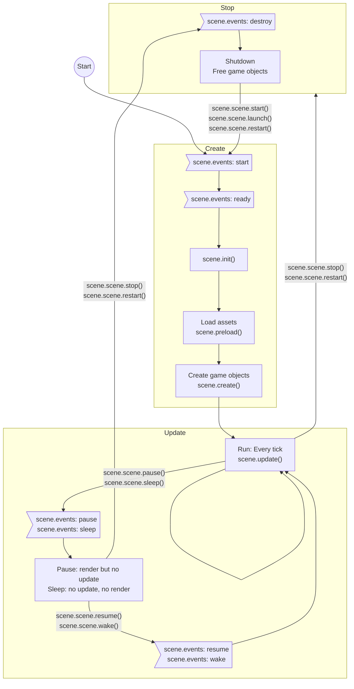

# 场景 {#page-title}

Phaser 4 指南 · [英文原文](https://phaser.io/oss/docs/phaser/concepts/scenes)

Phaser使用Scenes的概念来将游戏分成逻辑部分,一个场景可以像您喜欢的那样大,或者小,但是,一个场景的典型用途是装入屏幕,主菜单,游戏关卡,博士格斗,游戏中物品商店,高分表等,您可以像您喜欢的那样在游戏中拥有尽可能多的Scenes,当你开始的时候,你可能只有一两个,但是随着游戏的复杂度的提高,你会发现自己会添加更多的.

要了解,您不必每个文件有一个场景,如果您愿意,但这不是一个要求,您可以将您所有的场景都放在一个场景中,也可以将一个场景一个场景一个场面,完全由您决定.

内部有一个场景管理器。 此管理器是您在场景之间添加、 删除或切换时的交互内容。 也负责更新和渲染场景。 您完全控制了场景在游戏中渲染的顺序。 例如, 通常的做法是, 将场景完全用于处理您的游戏的 UI, 其渲染量高于其他场景 。

我们稍后会更详细地审视一个场景的生命周期,但现在值得理解的是,你可以随意暂停,恢复和睡眠一个场景,同时可以轻松地运行多个场景.

## 什么是场景? {#what-is-a-scene}

Phaser 2 中有游戏世界和州的概念。 一个国家允许您进入游戏世界, 只有一个国家可以同时运行。 国家可以访问各种系统, 如相机、 Tweens 和游戏对象工厂。 当你使用像 `this.add` 这样的命令时, 您正在和全球游戏对象工厂交谈。 一旦你和一个国家一起完成, 你将移动到下一个国家。 国家常常被分成逻辑部分, 如 Preloader State、 Main Menu State 等。

内 Phaser 3 我们完全改变了我们的做法, 第一个变化是国家被重新命名为Scases。 这样做是为了避免与游戏中常用的“ 状态机器” 产生模糊之处。 全球国家管理器也被替换为场景管理器。 这两个术语在概念上是可以互换的, 但Scee是使用和期待看到的正确术语 。 Phaser 3. 如果您在代码或网上找到的教程中找到任何提及国家的内容,则用于 Phaser 2,而且可能不会工作 Phaser 3. 变化不仅仅是在命名这些班级方面,它们比这要深入得多。

与其说Phaser管理一个“Game World ” 现在根本没有世界对象。 与其说Scenes只参考了Phaser.Game 实例拥有的所有系统, 不如说他们自己拥有它们。 你可以认为Scenes 几乎完全是自成一体的游戏世界。 他们管理自己的输入、 调制、 游戏对象、 显示列表、 相机等。 在Scen A 中创建的调制完全与在 Scen B 中创建的调式相分离 。

游戏本身唯一负责的就是将基于全球DOM的事件传递给Scenes,比如何时更新(从RequestAnimationFrame)或输入管理器的核心输入事件。这些事件的处理由Scenes自己完成。

### 游戏还控制着什么? {#what-does-game-still-control}

有一些系统本质上是全球性的,因此属于Game example。

* 朗德纳。每场比赛只有一次Canvas或WebGL 朗德纳,这是游戏对象的属性。
* 动画管理器。 Phaser 3 中的动画是全球性的, 不再与特定的游戏对象绑定。 您可以创建许多不同的动画, 这些动画都存储在动画管理器中, 然后任何游戏对象, 在任意场景中, 都可以使用它们, 而无需重复大量的数据和浪费内存 。
* 缓存。 当文件被 Scene 装入时, 将它们放在全局缓存中。 因此, 如果 Scene A 装入 XML 文件, XML 数据可以被任意 Scene 检索, 因为缓存是全局的 。
* 注册。 每个场景都有自己的数据管理器实例, 但游戏中也有一个您可以通过属性 `registry` 从场景中引用的。 这使得可以方便地进行跨场景数据交换( 如我们稍后在本指南中看到的)
* 输入管理器。 输入管理器在 Phaser 3 中很少做任何工作。 它只是监视和处理 DOM 级的输入事件, 如从指针、 游戏板或键盘中提升的输入事件。 每个场景都有自己的输入插件, 这是所有真实的事件都用它来操作, 也是您从场景中调用 `this.input` 时与它接口的 。
* 场景管理器 负责创建、 管理和更新游戏中的所有场景 。
* 设备检查器。 允许您对浏览器支持的功能进行投票, 并且您正在运行的游戏硬件。 设备类是单个单子, 每个浏览器只运行一次, 所以并不直接与您的游戏实例( 也就是说, 如果您有两款游戏实例运行在同一页上, 它们会共享全局设备检查器) 。
* 声音管理器。 和渲染一样, 声音由 Phaser 3. 中的全球系统管理。 您可以从您的 Scenes 中创建声音对象、 标记等, 但只有一个管理器可以同时运行, 以避免资源分配问题 。
* TimeStep. 此插件管理请求动画框架循环并更新核心游戏, 使其步入。 您很少需要直接与它互动 。

其他一切,如Tweens,物理,游戏对象和输入处理,都通过Scene关卡插件管理. Games现在只用于时间步和真正全局的系统,这不会说明每个场景复制是有意义的.

### 创建场景时会发生什么 {#what-happens-when-you-create-a-scene}

创建场景的方法有很多种,但基本的方法在它们中都是相同的。场景由场景配置对象和一系列功能组成。在这里,我们将用ES6的方法创建一个场景实例:

```js
class MyScene extends Phaser.Scene {

    constructor ()
    {
        super('MyFirstScene');
    }

    preload ()
    {
        this.load.image('logo', 'assets/sprites/logo.png');
    }

    create ()
    {
        this.add.image(400, 300, 'logo');
    }

}
```

我们延长 `Phaser.Scene` 对象并给它一个独特的密钥(在这种情况下) `MyFirstScene`) 。在构造器中。有两种方法: `preload` 财务报告和已审计财务报表 `create`。第一个加载图像,第二个显示图像。您没有_有_有_有_有 `preload` 方法,唯一要求成为有效场景的是 `create` 方法,因为这是所有屏幕在 Phaser 3.

使用ES5的同样情况如下:

```js
var MyScene = new Phaser.Scene('MyFirstScene');

MyScene.preload = function ()
{
    this.load.image('logo', 'assets/sprites/logo.png');
}

MyScene.create = function ()
{
    this.add.image(400, 300, 'logo');
}
```

### 游戏配置 {#game-configuration}

单凭自己创造场景还不够, 游戏中也需要添加它。 您可以在游戏创建时使用这样的游戏配置来完成 :

```js
var config = {
    type: Phaser.AUTO,
    width: 800,
    height: 600,
    scene: MyScene
};

var game = new Phaser.Game(config);
```

场景是通过 `scene` 属性传递到的。 如果您拥有多个场景, 也可以是场景的阵列。 无论ES5 或 ES6 , 都完全一样 。

如果你看过Phaser 3的例子 你可能已经看到一种完全不同的方法 来创造一个更像这个的场景:

```js
var config = {
    type: Phaser.AUTO,
    width: 800,
    height: 600,
    scene: {
        preload: preload,
        create: create
    }
};

var game = new Phaser.Game(config);

function preload ()
{
    this.load.image('logo', 'assets/sprites/logo.png');
}

function create ()
{
    this.add.image(400, 300, 'logo');
}
```

稍等一分钟,在ES6和ES5 Scenses中,我们在游戏配置中通过了其中的一个例子,但是在以上代码中,我们传递的是只有几处属性的实际对象(Scentral object).`preload` 财务报告和已审计财务报表 `create`) 转而使用。

之所以这样,是因为内部,场景管理者为决定它得到什么做了很多工作.

首先它查看游戏配置的 `scene` 属性。 如果它是数组, 然后依次浏览, 处理每个条目, 否则它只是处理第一个发现的条目。 它检查每个项目, 查看它属于什么类型, 即类, 对象或原型函数, 然后把它们变成完整的场景对象, 把它们添加到场景管理器中 。

归根结底,你用什么方法来定义你的场景,不管怎样,场景管理者一旦完成了他们,他们都得到了同样的内部待遇。当他们被转化为完整的场景时,他们得到了一些重要的增补,比如场景设置和系统,再加上相互沟通的能力。

#### 场景设置 {#scene-settings}

当您创建了场景时, 它提取了您在配置中可能定义的任何设置。 如果没有设置, 它只是使用默认设置。 设置是在一个传输到场景构建器的配置对象中定义的。 以下是从配置设置中设置场景名称和物理引擎的例子 :

```
class Level1Scene extends Phaser.Scene {

    constructor ()
    {
        super({
            key: 'Level1',
            physics: {
                arcade: {
                    debug: true,
                    gravity: { y: 200 }
                }
            }
        });
    }

}
```

设置对象也可以用来装入文件。 您真的应该只用它装入小文件, 因为用户从未收到过进度反馈。 使用以下语法 :

```
class BootScene extends Phaser.Scene {

    constructor ()
    {
        super({
            key: 'boot',
            files: [
                { type: 'image', key: 'bar', url: 'loaderBar.png' },
                { type: 'image', key: 'bg', url: 'background.png' }
            ]
        });
    }

}
```

资产在_ 之前被装入, 您的场景预装方法被调用 。

它适合装入极少数图形,即背景和进度栏图像,然后在装入游戏所有其它资产时,您可以显示预装机场景。或者您可以使用它装入内部游戏配置,在装入剩余资产之前可以解析该配置。

#### 场景系统 {#scene-systems}

当场景管理器创建您的场景时, 它会安装一个场景系统对象。 将它放置在属性 `sys` 上, 这意味着你不应该替换或覆盖您的游戏代码中的属性 `sys`, 或者非常糟糕的事情会发生 :

场景系统类是您场景的核心,它控制了所有的场景插件,释放事件,让你修改场景(如发送到睡眠,唤醒等),并允许所有插件相互交流.

它会自动在您的屏幕中安装 7 ** 核心插件 ** :

* 事件信息报
* 2D相机管理员
* 游戏对象创建器
* 游戏对象工厂
* 场景插件
* 显示列表
* 更新列表

从上面的列表中可以看出,每个场景都有自己的显示列表,工厂和相机系统。所以当你发出像`this.add.image`这样的命令时,你直接与基于场景的游戏对象工厂进行接口,并将由此产生的图像添加到场景级别显示列表中.

这些插件是不可选择的,因为它们都依赖对方在场。 所以每个场景都有它们。 然而, 您可以通过注射地图控制那些在场景对象上作为_ 属性_ 暴露的 。

还有一个 7 ** 默认插件 **。 这些插件安装在您的屏幕中, 除非您通过场景配置指定了其它内容 :

* 3D 相机管理器
* 时钟
* 数据管理器插件
* 输入插件
* 装入器插件
* 特温经理
* 灯光插件

上面的插件都是可选的。 与核心插件一样, 您可以使用注入图通过属性控制哪些插件。

#### 配置插件( E) {#configuring-plugins}

记住核心插件无法删除。 要删除所有默认插件, 您只需通过一个空插件阵列即可 :

```
class BootScene extends Phaser.Scene {

    constructor ()
    {
        super({
            key: 'boot',
            plugins: []
        });
    }

}
```

如果您现在尝试在您的场景中使用 `this.load`, 它将会失败, 因为装入器插件已被排除于此场景 。

如果您想要的只是装入器和Tween插件,但其他的都无,您可以指定这些:

```
class BootScene extends Phaser.Scene {

    constructor ()
    {
        super({
            key: 'boot',
            plugins: [ 'Loader', 'TweenManager' ]
        });
    }

}
```

如果您不确定创建您的场景时您需要哪个插件, 您可以通过场景系统安装它们。 必须以 `init` 方法进行 :

```
class BootScene extends Phaser.Scene {

    constructor ()
    {
        super({
            key: 'boot',
            plugins: []
        });
    }

    init ()
    {
        this.sys.install('TweenManager');
    }

}
```

给 `install` 的呼叫是让它安装默认插件 `TweenManager`, 允许您在此场景中添加 tweens 。

#### 弹出场景地图 {#scene-injection-map}

内 Phaser 2 国家管理者将在贵国境内创建不少于19个属性,这些属性都与全球游戏系统相关联。例如,它将涉及贵国,然后添加 `physics` 财产,它映射 物理经理, `scale` 映射到缩放管理器等 。

这是一把双刃剑。 它使得 Phaser 变得非常容易使用。 系统没有需要的模糊访问, 您只是打出输入, 并且就在那里。 但是, 您对注入的属性的数量或名称没有选择。 如果您真的想使用一个名为 `world` 的本地属性, 您不能不按字面的打破游戏。 如果您不小心翻过19 个默认属性中的其中之一, 也会打破游戏。 经验丰富的devs学会处理这个属性, 但我们觉得 Phaser 3 的更好方法。

为此,我们创建了 Scene 注射地图。 此对象控制器被映射到您所处地点的属性, 并控制这些属性的准确名称 。

默认情况下,以下所有属性都安装到场景中 :

'anims' = 动画管理器(全球)
cache = 快取( 全球)
“ game” = Phaser.Game 实例( 全球)
'registry'=游戏数据管理器(全球)
'sound' = 声音管理器( 全球)
纹理 = 纹理管理器( 全球)

添加=游戏对象工厂(本地,核心)
'cameras' = 2D 相机管理器(本地,核心)
“ 儿童” = 显示列表( 本地, 核心)
'evits' = Enitter(当地,核心)
“ make” = 游戏对象创建器( 本地, 核心)
“ scene” = 场景管理器插件( 本地, 核心)

以下属性只有在相应的插件可用的情况下才会安装到场景中:

'cameras3d' = 3D 相机管理器(本地,可选)
'data' = 场景数据管理器(本地,可选)
“影响”=撞击物理(当地、可选)
“ 输入” = 输入插件( 本地、 可选)
'lights' = 灯光管理器插件( 本地, 可选)
“ load” = 装入器插件( 本地、 可选)
“ 物质” = 物质 JS 物理( 本地、 可选)
物理=弧形物理(局部,可选)
“ 时间” = 时间/ 时钟插件( 本地, 可选)
'tweens'=tween 管理器(本地,可选)

如果您更愿意选择不给您的场景添加任何属性 :

```
class BootScene extends Phaser.Scene {

    constructor ()
    {
        super({
            key: 'boot',
            map: {}
        });
    }

}
```

或者您可以更改使用 `map` 对象注入的属性名称。 在此我们将用西班牙语等值替换英文属性 :

```
class BootScene extends Phaser.Scene {

    constructor ()
    {
        super({
            key: 'boot',
            map: {
                add: 'agregar',
                anims: 'animaciones',
                cameras: 'camaras',
                events: 'eventos',
                load: 'cargar',
                sound: 'sonido'
            }
        });
    }

    preload ()
    {
        this.cargar.image('face', 'assets/bw-face.png');
    }

    create ()
    {
        this.agregar.image(400, 300, 'face');
    }

}
```

如果您的IDE支持, 您甚至可以使用 UTF8, 例如这个简化的中文版本 :

```
class BootScene extends Phaser.Scene {

    constructor ()
    {
        super({
            key: 'boot',
            map: {
                add: '加',
                load: '加载'
            }
        });
    }

    preload ()
    {
        this.加载.image('face', 'assets/pics/bw-face.png');
    }

    create ()
    {
        this.加.image(400, 300, 'face');
    }

}
```

## 场景回调 {#scene-callbacks}

场景回调法是`init()`,`preload()`,`create()`,以及`update()`. 拱顶式回调法是:

```js
// Configure this scene cycle
function init(data) {}

// Queue assets for downloading
function preload() {}

// Create game objects with loaded assets
function create(data) {}

// Work on game objects at each game step
function update(time, delta) {}
```

`init()`的使用较少.

您可以在任意方法中创建游戏对象, 但如果您已经将资产排队于 `preload()` 中, 那么您将无法在 `create()` 之前使用这些资产 。

如果你不使用`preload()`,那么模式就是:

```js
// Create game objects
function create(data) {}

// Work on game objects at each game step
function update(time, delta) {}
```

或使用`init()`或`create()`.

在场景回调中,[this](https://developer.mozilla.org/en-US/docs/Web/JavaScript/Reference/Operators/this)是场景。如果你不太喜欢使用`this`,你可以将其分配到一个变量:

```js
let scene;

function init() {
  if (scene) throw new Error("Only one scene can use the `scene` variable");

  scene = this;

  scene.events.once("destroy", () => {
    scene = null;
  });
  scene.events.once("shutdown", () => {
    scene = null;
  });
}
```

或者你可以在回调中解构它:

```js
function create() {
  const { add, cameras, events } = this;

  add.sprite(/*…*/);
}
```

## 场景创建 {#scene-creation}

场景可以由类或配置对象创建,它们通过[Scene Manager](/api/class/scenes-scenemanager)添加到游戏中,这可以通过游戏配置,`add()`方法,或者(稀有)[load.scene()](/api/class/loader-loaderplugin#scene)来完成.

* 如果给出了配置对象,则会立即复制一个新的 `Phaser.Scene` ,并将部分配置值复制到它上.
* 给某类者,即即时之说.
* 现场被踢出。
* 现场已经开始了,如果你表示。

场景管理器列表中的每一场景都是一个被踢出的物品(内幕),并且持续到被移除(毁损).

### 场景创建基础 {#scene-creation-basics}

#### 使用 ES6 类 {#using-an-es6-class}

```js
class MyScene extends Phaser.Scene {
  constructor(config) {
    super(config);
  }

  init(data) {}
  preload() {}
  create(data) {}
  update(time, delta) {}
}
```

* `data`:参数通过自[adding new scene](#add-a-scene-from-a-config-object),或[starting scene](#start).

#### 使用类 {#using-a-class}

```js
var MyScene = new Phaser.Class({
  Extends: Phaser.Scene,

  initialize: function MyScene(config) {
    Phaser.Scene.call(this, config);
  },

  init: function (data) {},
  preload: function () {},
  create: function (data) {},
  update: function (time, delta) {},
});
```

* `data`:参数通过自[adding new scene](#add-a-scene-from-a-config-object),或[starting scene](#start).

```js
var MyGame = {};

MyGame.Boot = function () {};

MyGame.Boot.prototype.constructor = MyGame.Boot;

MyGame.Boot.prototype = {
  init: function (data) {},
  preload: function () {},
  create: function (data) {},
  update: function (time, delta) {},
};
```

* `data`:参数通过自[adding new scene](#add-a-scene-from-a-config-object),或[starting scene](#start).

#### 覆盖默认回调 {#overriding-default-callbacks}

```js
var demo = new Phaser.Scene("Demo");

demo.init = function (data) {};
demo.preload = function () {};
demo.create = function (data) {};
demo.update = function (time, delta) {};
```

* `data`:参数通过自[adding new scene](#add-a-scene-from-a-config-object),或[starting scene](#start).

### 创建单场游戏 {#creating-a-single-scene-game}

最简单的是使用游戏配置,当只给出一个场景时,它会自动启动.

#### 游戏配置中的场景配置 {#a-scene-config-in-the-game-config}

```js
const sceneConfig = {
  create: function () {
    /*…*/
  },
};

new Phaser.Game({
  scene: sceneConfig,
});
```

#### 游戏配置中的场景类 {#a-scene-class-in-the-game-config}

```js
class Scene extends Phaser.Scene {
  create() {
    /*…*/
  }
}

new Phaser.Game({
  scene: Scene,
});
```

#### 游戏配置中的场景实例 {#a-scene-instance-in-the-game-config}

```js
class Scene extends Phaser.Scene {
  create() {
    /*…*/
  }
}

new Phaser.Game({
  scene: new Scene(),
});
```

您也可以使用`scene.add()`,尽管本案没有很大的优势. `autoStart`(第三个参数)是指在添加时开始现场.

#### 从配置对象添加一个场景 {#add-a-scene-from-a-config-object}

```js
const sceneConfig = {
  create: function () {
    /*…*/
  },
};

new Phaser.Game({
  callbacks: {
    preBoot: (game) => {
      game.scene.add("default", sceneConfig, true);
    },
  },
});
```

#### 从场景类添加场景 {#add-a-scene-from-a-scene-class}

```js
class Scene extends Phaser.Scene {
  create() {
    /*…*/
  }
}

new Phaser.Game({
  callbacks: {
    preBoot: (game) => {
      game.scene.add("default", Scene, true);
    },
  },
});
```

#### 从场景实例添加一个场景 {#add-a-scene-from-a-scene-instance}

```js
class Scene extends Phaser.Scene {
  create() {
    /*…*/
  }
}

new Phaser.Game({
  callbacks: {
    preBoot: (game) => {
      game.scene.add("default", new Scene(), true);
    },
  },
});
```

注意`scene.add()`, 它可能提供 冲突场景键:

```js
// OOPS
game.scene.add("yin", new Scene("yang"), true);
```

在这种情况下,现场与键"阳"即时化,然后场景管理器将键改为"yin".

### 创建多场游戏 {#creating-a-multi-scene-game}

在多场游戏中,每个场景都需要独特的密钥.

再一次,在游戏配置中加入场景是最简单的,第一个场景加上任何附加的场景,加上`{ active: true }`,都是自动开始的.

#### 游戏配置中的多个场景配置 {#multiple-scene-configs-in-the-game-config}

```js
const bootSceneConfig = { key: 'boot', /*…*/ };
const playSceneConfig = { key: 'play', /*…*/ };
const uiSceneConfig = { key: 'ui', active: true };

new Phaser.Game({
  // 'boot' and 'ui' will be started
  scene: [ bootSceneConfig, playSceneConfig, uiSceneConfig ]
};
```

#### 游戏配置中的多个场景实例 {#multiple-scene-instances-in-the-game-config}

```js
// Scene classes:
class BootScene {
  /*…*/
}
class PlayScene {
  /*…*/
}
class UIScene {
  /*…*/
}

new Phaser.Game({
  // 'boot' and 'ui' will be started
  scene: [
    new BootScene("boot"),
    new PlayScene("play"),
    new UIScene({ key: "ui", active: true }),
  ],
});
```

你可以在他们的构造器中[configure scenes](#scene-configuration-object),如果你喜欢的话。

#### 多个场景来自一个基础配置 {#multiple-scenes-from-a-base-config}

```js
const levelSceneConfig = { preload, create, update };
const level1SceneConfig = { ...levelSceneConfig, key: 'level1' };
const level2SceneConfig = { ...levelSceneConfig, key: 'level2' };

new Phaser.Game({
  scene: [ level1SceneConfig, level2SceneConfig ]
};
```

#### 一个类的多个场景 {#multiple-scenes-from-one-class}

```js
class LevelScene {/*…*/};

new Phaser.Game({
  scene: [ new LevelScene('level1'), new LevelScene('level2') ]
};
```

##### 双幕游戏 {#a-2-scene-game}

```js
class Boot extends Phaser.Scene {
  // Load assets
  preload() {}

  // Start Play scene
  create() {}
}

class Play extends Phaser.Scene {
  // Create game objects with loaded assets
  create() {}

  // Update the scene
  update() {}
}

new Phaser.Game({
  scene: [
    // Only 'boot' will start.
    new Boot("boot"),
    new Play("play"),
  ],
});
```

### 游戏启动后列出场景 {#listing-scenes-after-game-boot}

```js
new Phaser.Game({
  scene: [
    /* etc. */
  ],
  callbacks: {
    postBoot: function (game) {
      game.scene.dump();
      // Look for output in console.
    },
  },
});
```

## 场景配置对象 {#scene-configuration-object}

以下是一个场景配置对象的例子:

```js
var config = {
  key: "",
  // active: false,
  // visible: true,
  // pack: false,
  // cameras: null,
  // map: {},
  // physics: {},
  // loader: {},
  // plugins: false,
  // input: {}
};
```

* `key`: 此场景的独有密钥。 必须在游戏的全部实例中独有 。
* `active`: 场景是否以活动开始? 活动场景更新每个步骤 。
* `visible`: 场景的开始是否是可见的? 一个可见的场景使每个步骤都成形.
* `pack`:在场景开始前可以选择加载的[Loader Packfile](/guide/concepts/loader#file-pack).
* `cameras` : 备选 [Camera configuration object](/guide/concepts/cameras#create-cameras-from-json).

  ```js
  {
      name: '',
      x: 0,
      y: 0,
      width: scene.sys.scale.width,
      height: scene.sys.scale.height,
      zoom: 1,
      rotation: 0,
      scrollX: 0,
      scrollY: 0,
      roundPixels: false,
      visible: true,
      backgroundColor: false,
      bounds: null, // {x, y, width, height}
  }
  ```

- `map`:覆盖一个场景的默认注射地图.
* `physics`:场景的物理配置对象.

  ```js
  {
      default: 'arcade', // 'arcade', or 'matter'
      arcade: {...},
      matter: {...}
  }
  ```

  * `arcade` : [Arcade Physics configuration](/guide/concepts/physics/arcade#configuration).
  * `matter` : [Matter Physics configuration](https://phaser.io/oss/docs/phaser/concepts/physics/matter.md#configuration).
* `loader`:场景的装填器配置对象.

  ```js
  {
      baseURL: '',
      path: '',
      enableParallel: true,
      maxParallelDownloads: 4,
      crossOrigin: undefined,
      responseType: '',
      async: true,
      user: '',
      password: '',
      timeout: 0
  }
  ```

- `plugins`:场景的插件配置对象.

  ```js
  {
      global: [
          //{key, plugin, start}
      ],
      scene: [
          // ...
      ]
  }
  ```

- `input`:景区输入配置对象.

## 场景生命周期 {#scene-life-cycle}

场景被踢出一次,可以发动多次(或永远不),持续到被移除(毁坏).

一个还没有加入经理的场景有状态`PENDING`.

已经添加到管理器中但从未开始的场景具有状态`INIT`. (这意味着"启动",与场景`init()`方法无关).

当一个场景开始时,它会经历状态 `START`, `LOADING` (如果资产在 `preload()`), `CREATING`,和 `RUNNING`. 其方法 `init()`, `preload()`,和 `create()` 如果存在,也称它们。 `update()` 被调用到每个游戏步骤,而场景则在 `RUNNING` 州立大学。

`RUNNING`场景可以改为`PAUSED`,通过暂停/再休整或`SLEEPING`,通过睡眠/醒后返回.

已被停止的场景具有 `SHUTDOWN` 状态, 可以重新开始 。

已被移除/毁坏的场景具有`DESTROYED`状态,不能再使用.

场景是**活动** 仅在 `START`, `LOADING`, `CREATING`,和 `RUNNING`;和 ** 仅在 `START`, `LOADING`, `CREATING`, `RUNNING`,和 `PAUSED`.

### 流程图:场景生命周期 {#flowchart-scene-life-cycle}



* `Run`: 更新和渲染
* `Pause` : 渲染但无更新
* `Sleep` : 没有更新,没有渲染
* `Stop` 关闭( O)

### 改变场景 {#changing-scenes}

有很多方法,因为它取决于你想做什么,Phaser让你同时运行多个场景.

#### 场景操作 {#scene-operations}

基本操作对是**暂停-恢复**,**睡眠-觉醒**,以及**shutdown-start**。

通常,以典型的游戏剧情,您会以**start**进入剧情,并以**shutdown**退出. Gameplay从每次开始.

但是为了移动到一个任务间歇场景并返回,你可能与**睡眠**一起退出游戏游戏场景,然后与**醒**一起重新进入,它隐藏在同时期,但玩家返回到他们离开的状态.

换到模式场景然后返回,你可能会用**暂停**退出游戏场景,然后用**resume**重新进入游戏场景。在这种情况下,它仍然可以看见,但暂停。

使用菜单或标题屏幕等您期望玩家重温的场景,您可以选择 **sleep - wake ** 或 **shutdown - start ** 。 睡眠 - 醒来模式可能更容易管理。 仅从一次开始的场景更容易解释。

#### 场景控制方法 {#scene-control-methods}

##### 简单方法 {#the-simple-methods}

* `launch()`和`stop()`确实开始和关闭.
* `sleep()` and `wake()` do sleep and wake.
* `pause()`和`resume()` 暂停并恢复。

##### 有条件的方法 {#the-conditional-methods}

* `run()`可能会开始,唤醒,或者恢复一个场景
* `switch()`可能会开始或唤醒一个场景

##### “双重”方法 {#the-double-methods}

这些都影响到目标场景和呼叫场景,它们方便一次一次穿越一个场景.

* `start()`停止了呼叫现场。
* `switch()`睡了电话现场。

##### 启动( ) {#start}

`start('target')`启动目标场景并停止呼叫场景,相当于`stop().launch('target')`.

如果你想在不停车的情况下开始第二场比赛,请使用`launch('target')`代替.

```js
// In scene A: stop A, start B
this.scene.start("B");

// In scene B: stop B, start C
this.scene.start("C");

// In scene C: stop C, start A again
this.scene.start("A");
```

##### 切换( ) {#switch}

`switch('target')`开始或唤醒目标场景,并睡眠呼叫场景.

```js
// In scene A: sleep A, start B
this.scene.switch("B");

// In scene B: sleep B, start C
this.scene.switch("C");

// In scene C: sleep C, *wake* A
this.scene.switch("A");
```

这里每个场景只开始一次,从未关闭.

等效`switch()`是:

```js
this.scene.sleep();

if (this.scene.isSleeping('target') {
  this.scene.wake('target');
} else {
  this.scene.launch('target');
}
```

`switch()` **重新开始**一个暂停的场景,永远不恢复——参见`run()`.

##### 发射() {#launch}

`launch()`开始或重启目标场景,它从不恢复或醒悟——参见`run()`.

##### 运行( A) {#run}

`run()`如果暂停,则恢复目标场景;如果睡觉,则唤醒它;如果运行,则重新启动它;然后以其他方式启动它.

### 重启一个场景的问题 {#problems-restarting-a-scene}

一些常见原因:

* 自己的状态变量尚未重置
* 您正在工作上一个场景周期的无效对象, 例如游戏对象或相机
  * 通常,一个被销毁的游戏对象的方法仍然被注册到事件发送器

#### 示例:重新启动后状态不佳 {#example-bad-state-after-restart}

```js
let gameOver = false;

function update() {
  if (gameOver) {
    // GAME OVER :(
  }
}
```

重启后,它立即被使用_GAME OV_,因为`gameOver`变量尚未被重置。

```js
let gameOver;

function init() {
  gameOver = false;
}

function update() {
  if (gameOver) {
    // GAME OVER :(
  }
}
```

在场景课中,你可能会在场景构造器中引入同样的问题:

```js
class Scene extends Phaser.Scene {
  constructor() {
    super();

    this.gameOver = false;
  }
}
```

重写类似:

```js
class Scene extends Phaser.Scene {
  constructor() {
    super();

    this.gameOver;
  }

  init() {
    this.gameOver = false;
  }
}
```

#### 示例:重启后无效的游戏对象 {#example-invalid-game-objects-after-restart}

```js
const sprites = [];

function create() {
  sprites.push(this.physics.add.sprite(/*…*/));
}

function update(time) {
  for (const sprite of sprites) {
    sprite.setVelocity(1, 1);
    // > TypeError: undefined is not an object (evaluating 'this.body.setVelocityX')
  }
}
```

在此您在重启此场景后会发现一个错误。 上一周期中被销毁的图案仍然在 `sprites` 阵列中。 重写为

```js
function create() {
  // …

  this.events.once("shutdown", () => {
    sprites.length = 0;
  });
}
```

### 移除一个场景 {#removing-a-scene}

如果你再也不能使用一个场景,你可以删除它:

```js
this.scene.destroy();
```

#### 用相同的键替换一个场景 {#replacing-a-scene-with-the-same-key}

在原场景被移除之前,不能重新使用密钥.

##### 场景会自己消失 {#a-scene-removing-itself}

```js
// After destruction, `this.scene` and `this.sys.scenePlugin` are unusable.
// So we need to use the manager directly.
const { manager } = this.scene;

this.events.once('destroy', () => {
  manager.add('key', newScene);
}

this.scene.remove();
```

##### 另一幕删除了第一幕 {#a-second-scene-removing-the-first}

```js
sceneToRemove.events.once('destroy', () => {
  this.scene.add('key', newScene);
}

this.scene.remove(sceneToRemove);
```

##### 一种选择 {#an-alternative}

与其拼凑场景键,不如使用动态键.

```js
this.registry.set("levelSceneKey", "level1");

this.scene.remove(this.registry.get("levelSceneKey"));

this.registry.set("levelSceneKey", "level2");

this.scene.add(this.registry.get("levelSceneKey"), Level, true);
```

## 场景系统和插件 {#scene-systems-and-plugins}

Scases有自己的系统,[core plugins](/api/namespace/plugins-defaultplugins#CoreScene)总是安装的,[default plugins](/api/namespace/plugins-defaultplugins#DefaultScene)是安装的,除非被禁用。在游戏配置中您添加的`{ start: true }`或任何`{ mapping: … }`的任何额外的场景插件也是默认的插件.

如果您在游戏配置中添加了没有这些的场景插件,插件并不是默认安装的,可以通过将它的密钥添加到`plugins`阵列中,在特定的场景中安装: .

```js
new Phaser.Scene({
  plugins: [
    ...Phaser.Plugins.DefaultPlugins.DefaultScene,
    "SomeOtherPluginKey",
  ],
});
```

您也可以这样删除默认插件 :

```js
new Phaser.Scene({
  // "DataManagerPlugin", "Loader", and "LightsPlugin" are omitted.
  plugins: ["Clock", "InputPlugin", "TweenManager"],
});
```

物理插件不同。 如果游戏配置的 `physics.default` 是 `'arcade'` 或 `'matter'` , 或者如果场景设置配置包括 `physics.arcade` 或 `physics.matter` 配置对象(即使空), 它们会被安装在一个场景中 。

### 表格: 系统和插件 {#table-systems-and-plugins}

下表列出系统和插件(下表粗体)以及一些全球系统的参考文献.

这些可以叫[mapped onto different property names](https://labs.phaser.io/edit.html?src=src\scenes\scene%20injection%20map.js),如果你喜欢的话。

| 场景        | 系统           | 页:1                                      |
| ------------ | ----------------- | ------------------------------------------ |
| ** 添加** 。      | 自动添加sys.add           | 核心插件                                |
| 动画        | 动画系统         |
| 缓存        | sys.cache (英语).         |
| 摄像机**  | 赛斯. 骆驼场       | 核心插件                                |
| ** 儿童** | 赛斯. displayList   | 核心插件                                |
| ** 数据**     | sys.data (英语).          | 默认插件                             |
| ** 活动**   | 活动        | 核心插件,不同于`game.events`. |
| Facebook 页面     | sys.facebook (英语).      |
| 游戏         | sys.game (英语).          |
| ** 投入**    | sys.infut (英语).         | 默认插件                             |
| ** 灯光**   | 灯光        | 默认插件                             |
| ** 载荷**     | sys. load (英语).          | 默认插件                             |
| 做点什么吧     | 赛斯,做          | 核心插件                                |
| ** 事项**   | 赛斯. matterPhysics | 选择插件                            |
| 物理学**  | 赛斯. arcadePhysics | 选择插件                            |
| 插件      | sys.plugins (英语).       |
| 登记     | 登记系统      |
| 渲染器     | sys.resder (英语).      |
| 缩放        | sys.scale 系统缩放         |
| 风景**    | 赛斯. scenePlugin   | 核心插件                                |
| 声音        | 音响         |
| 纹理     | 文本编辑器      |
| ** 时间**     | 秒时          | 默认插件                             |
| ** 双关语**   | sys.tweens (英语).        | 默认插件                             |

## 渲染 {#rendering}

场景从第一到最后一段( 从下到上) 。 您可以用 Scene 管理器方法如 `bringToTop()` 或 `sendToBack()` 来重新排列它们, 但这是不寻常的, 除了一些视觉效果。 在改变场景时不要使用这些方法“ 固定” 可见问题 。 您可能应该使用睡眠/ 醒醒或开始/ 停止。 请记住您可以将您所有的场景定义添加到游戏配置中, 从而确定在那里的渲染顺序, 即使对于没有立即开始的场景也是如此 。

你可以用`scene.setVisible()`切换一个场景的能见度,这不会改变场景的状态.

## 场景事件 {#scene-events}

* 开始( `scene.init()`)

  ```js
  scene.events.on("start", function () {});
  ```

- 准备(`start`之后)

  ```js
  scene.events.on("ready", function () {});
  ```

- 每点
  * Preupdate

    ```js
    scene.events.on("preupdate", function (time, delta) {});
    ```

  * Update

    ```js
    scene.events.on("update", function (time, delta) {});
    ```

  * Postupdate

    ```js
    scene.events.on("postupdate", function (time, delta) {});
    ```

  * Render

    ```js
    scene.events.on("render", function () {});
    ```

- 状态已更改
  * 暂停( 从 `scene.scene.pause()`)

    ```js
    scene.events.on("pause", function () {});
    ```

  * 恢复(从`scene.scene.resume()`)

    ```js
    scene.events.on("resume", function () {});
    ```

  * 睡觉(来自`scene.scene.sleep()`)

    ```js
    scene.events.on("sleep", function () {});
    ```

  * 醒来(从`scene.scene.wake()`)

    ```js
    scene.events.on("wake", function () {});
    ```

  * 停止/关闭( 从 `scene.scene.stop()`)

    ```js
    scene.events.on("shutdown", function () {});
    ```

    * **空闲本场可能使用的任何资源**
* 销毁(从`scene.scene.remove()`)

  ```js
  scene.events.on("destroy", function () {});
  ```

- Resize

  ```js
  scene.events.on("resize", function () {});
  ```

- Boot

  ```js
  scene.events.on("boot", function () {});
  ```

- 游戏对象添加到场景
  * Add

    ```js
    scene.events.on("addedtoscene", function (gameObject, scene) {});
    ```

  * Remove

    ```js
    scene.events.on("removedfromscene", function (gameObject, scene) {});
    ```

## 作者署名 {#author-credits}

本页包含以下作者贡献的内容。

* [RexRainbow](https://github.com/rexrainbow)
* [samme](https://github.com/samme)

---
