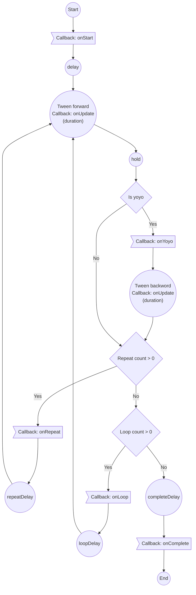

# 补间动画 {#page-title}

Phaser 4 指南 · [英文原文](https://phaser.io/oss/docs/phaser/concepts/tweens)

补间动画（Tween）可以让对象属性在指定时间内平滑地变化。比如让精灵从一个位置移动到另一个位置，或者把游戏对象的 `alpha` 从 1 变到 0，使它逐渐淡出。每个场景都有自己的补间动画管理器，可通过 `this.tweens` 访问。

目标可以是游戏对象、声音、摄像机，也可以是普通 JavaScript 对象。例如，你可以逐渐降低音量，移动摄像机，或者让界面上的分数从旧值过渡到新值。

一次补间可以控制多个对象和属性，也可以设置延迟、缓动、插值、重复和往返播放（`yoyo`）。多个补间还可以串成一条链，前一个完成后自动开始下一个。

## 基本用法 {#basic-usage}

### 创建补间动画 {#creating-a-tween}

```js
var tween = scene.tweens.add({
    targets: gameObject,
    x: 1,
    // x: '+=1',
    // x: '-=1',
    // x: '*=1',
    // x: '/=1',
    // x: 'random(0.25, 0.75)',
    // x: 'int(10, 100)',
    // x: [100, 300, 200, 600],
    // x: { from: 0, to: 1 },
    // x: { start: 0, to: 1 },  
    // x: { start: value0, from: value1, to: value2 },  
    // x: {
    //      getActive: function (target, key, value, targetIndex, totalTargets, tween) { return newValue; },
    //      getStart: function (target, key, value, targetIndex, totalTargets, tween) { return newValue; },
    //      getEnd: function (target, key, value, targetIndex, totalTargets, tween) { return newValue; }
    // },
    ease: 'Linear',       // 'Cubic', 'Elastic', 'Bounce', 'Back'
    duration: 1000,
    repeat: 0,            // -1: infinity
    yoyo: false,

    // interpolation: null,
});
```

- `key: value2` : 调图为 `value2`.
- `key: '+=deltaValue'`: 补间为当前值+deltaValue
    - 支持这些表达式 : `key: '+=deltaValue'`, `key: '-=deltaValue'`, `key: '*=deltaValue'`, `key: '/=deltaValue'`
- `key: 'random(10, 100)'` : 补间到随机浮点值.
- `key: 'int(10, 100)'` : 调和到随机的内值.
- `key: [100, 300, 200, 600]` : 使用( U) `interpolation` 用于确定数值。
- `key: { from: value1, to: value2 }`:当延迟后开始时,将属性设定为`value11`,然后将属性设定为`value2`.
   - `value1`,`value2`:一个数字,字符串,或回调(`function(target, key, value, targetIndex, totalTargets, tween)  { return newValue; }`)   
- `key: { start: value0, to: value2 }` : 设置属性为 `value0` 立即,然后转动到 `value2`.
    - `value1`,`value2`:一个数字,字符串,或回调(`function(target, key, value, targetIndex, totalTargets, tween)  { return newValue; }`)  
- `key: { start: value0, from: value1, to: value2 }`:将属性立即设置为`value0`,然后在延迟后开始时设置为`value1`,然后设置为`value2`.
    - `value0`,`value1`,`value2`:一个数字,字符串,或回调(`function(target, key, value, targetIndex, totalTargets, tween)  { return newValue; }`).  
- `key: function(target, key, value, targetIndex, totalTargets, tween)  { return newValue; }`
    - `target` :  靶.
    - `key` :目标属性.
    - `value`:目标属性的当前值.
    - `targetIndex` :图文内目标指数.
    - `totalTargets` :这个图文中的目标总数.
    - `tween` :引用这个回调的特温.
- `key: { getActive:callback, getStart:callback, getEnd:callback}`
    - `callback` : `function(target, key, value, targetIndex, totalTargets, tween)  { return newValue; }`

or

```js
var tween = scene.tweens.add({
    targets: gameObject,
    paused: false,
    callbackScope: tween,

    // timming/callback of each state
    onStart: function () {},
    onStartParams: [],

    // initial delay
    delay: 0,  // function(target, targetKey, value, targetIndex, totalTargets, tween) { },

    // tween duration
    duration: 1000,
    ease: 'Linear',
    easeParams: null,

    onActive: function () {},
    onUpdate: function (tween, target, key, current, previous, param) {},
    onUpdateParams: [],

    // delay between tween and yoyo
    hold: 0,
    yoyo: false,  // true to tween backward
    flipX: false,
    flipY: false,
    onYoyo: function (tween, target, key, current, previous, param) {},
    onYoyoParams: [],

    // repeat count (-1: infinite)
    repeat: 0,
    onRepeat: function (tween, target, key, current, previous, param) {},
    onRepeatParams: [],
    // delay to next pass
    repeatDelay: 0,

    // loop count (-1: infinite)
    loop: 0,
    onLoop: function () {},
    onLoopParams: [],
    // delay to next loop
    loopDelay: 0,

    // delay to onComplete callback
    completeDelay: 0,
    onComplete: function () {},
    onCompleteParams: [],
    // timming/callback of each state

    onStop: function () {}, 
    onPause: function () {}, 
    onResume: function () {}, 

    // properties:
    x: '+=600',        // start from current value
    y: 500,
    rotation: ...
    angle: ...
    alpha: ...
    // ...

    // or
    props: {
        x: { value: '+=600', duration: 3000, ease: 'Power2' },
        y: { value: '500', duration: 1500, ease: 'Bounce.easeOut' }
    },

    // or
    props: {
        x: {
            duration: 400,
            yoyo: true,
            repeat: 8,
            ease: 'Sine.easeInOut',
            value: {
                getActive: function (target, key, value, targetIndex, totalTargets, tween)
                {
                    return value;
                },
                getStart: function (target, key, value, targetIndex, totalTargets, tween)
                {
                    return value + 30;
                },
                getEnd: function (target, key, value, targetIndex, totalTargets, tween)
                {
                    destX -= 30;
                    return destX;
                }
            }
        },
        ....
    },

    persist: false,

    interpolation: null,
    interpolationData: null,

});
```

- `targets` : 目标 tween正在更新.
- `delay` : 时间轮回将等待它开始之前
    - 所有目标都有一个数字
    - 通过交错构建器构建的召回函数 :
        - 从`0`到`endValue`: 
            - `scene.tweens.stagger(endValue)`
        - 从`startValue`到`endValue`: 
            - `scene.tweens.stagger([startValue, endValue])`
        - 从`0`到`endValue`,具有特定的易操作功能: 
            - `scene.tweens.stagger(endValue, {ease: 'cubic.inout'})`
        - 从`startValue`到`endValue`,具有特定的易操作功能: 
            - `scene.tweens.stagger([startValue, endValue], {ease: 'cubic.inout'})`
        - 从`0`到`endValue`, 并附有具体的起始索引 :
            - `scene.tweens.stagger(endValue, {from: 'last'})`
            - `scene.tweens.stagger(endValue, {from: 'center'})`
            - `scene.tweens.stagger(endValue, {from: index})`
        - 从`startValue`到`endValue`, 并附有具体的起始索引 :
            - `scene.tweens.stagger([startValue, endValue], {from: 'last'})`
            - `scene.tweens.stagger([startValue, endValue], {from: 'center'})`
            - `scene.tweens.stagger([startValue, endValue], {from: index})`
        - 从`0`到`endValue`,具有特定的易操作功能,并带有特定的起始索引 : 
            - `scene.tweens.stagger(endValue, {from: 'last', ease: 'cubic.inout'})`
        - 从`startValue`到`endValue`,具有特定的易操作功能,并带有特定的起始索引 :
            - `scene.tweens.stagger([startValue, endValue], {from: 'last', ease: 'cubic.inout'})`
        - 网格模式 从`0`到`endValue`
            - `scene.tweens.stagger(endValue, {grid: [gridWidth, gridHeight], })`
            - `scene.tweens.stagger(endValue, {grid: [gridWidth, gridHeight], from: 'center'})`
            - `scene.tweens.stagger(endValue, {grid: [gridWidth, gridHeight], from: 'center', ease: 'cubic.inout'})`
        - 网格模式 从`startValue`到`endValue`
            - `scene.tweens.stagger([startValue, endValue], {grid: [gridWidth, gridHeight], })`
            - `scene.tweens.stagger([startValue, endValue], {grid: [gridWidth, gridHeight], from: 'center'})`
            - `scene.tweens.stagger([startValue, endValue], {grid: [gridWidth, gridHeight], from: 'center', ease: 'cubic.inout'})`
- `duration`:   的长度
- `ease`:   使用的易功能
- `easeParams`: 随易函数( 如果有) 的参数
- `hold` : 运行 Yyo 之前, 时轮会暂停
- `repeat`:  会重复的次数(值为1表示  会玩两次,因为重复一次)
- `repeatDelay`:在重现前, 时间将暂停。 时间将停留在起始状态 。
- `yoyo`:布尔 -   在到达尾声时会反转吗(yoyo)?
- `flipX` : 翻转 X 游戏对象于 tween 端
- `flipY` : 在 tween 结尾翻转 Y 游戏对象
- `completeDelay`:onComplete事件完成后, 时间会等到活动结束后发出
- 用于无限循环的 `loop`: `-1`
- `loopDelay`
- `paused` :  是以暂停状态开始的,还是播放?
- `props`: 属性被  子变形
- `onActive` :Tween在Tween管理器内部变得活跃.
    ```js
    function(tween, target) { }
    ```
- `onStart` 曰:  始发.
    ```js
    function(tween, targets) { }
    ```
- `onUpdate`: 更新时发射的调回
    ```js
    function(tween, target, key, current, previous, param) { }
    ```
- `onComplete` :Tween完成或停止.
    ```js
    function(tween, targets) { }
    ```
- `onYoyo` : 每次调用 tween yoyos 的函数。每个目标每次调用一次 。
    ```js
    function(tween, target, key, current, previous, param) { }
    ```
- `onLoop`:每次调用调用调用调用调用环的函数.
    ```js
    function(tween, targets) { }
    ```
- `onRepeat`:每次重复调用时,每个目标每个属性调用一次的函数.
    ```js
    function(tween, target, key, current, previous, param) { }
    ```
- `onStop`:当调用停止时调用函数 。
    ```js
    function(tween, targets) { }
    ```
- `onPause`:当调用时调用调用调用调用调用调用调用调用调用调用调用调用调用调用调用调用调用调用调用调用调用调用调用调用调用调用调用调用调用调用调用调用调用调用调用调用调用调用调用调用调用调用调用调用调用调用调用调用调用调用调用调用调用调用调用调用调用调用调用调用调用调用调用调用调用调用调用调用调用调用调用调用调用调用调用调用调用调用调用调用调用调用调用调用调用调用调用调用调用调用调用调用调用调用调用调用调用调用调用调用调用调用调用调用调用调用调用调用调用调用调用调用调用调用调用调用调用调用调用调用调用调用调用调用调用调用调用调用调用调用调用调请请请请请请请请请请请请请请请请请请请请请请请请请请请请请请请请请请电电电电电电电电电电电电电电电电电电电电电电电电电电电电电电电电电电电电请请请电电电电电电电电电电电电电电电电电电电电电电电电电电电电电电电电电电电电电电电电电电电电电电电电电电电电电请请请电电请电请电请电请电请电请电电电请电请电电电电电请电请电请电请电电请电请电请电请电请电请电请电请
    ```js
    function(tween, targets) { }
    ```
- `onResume`:一个在暂停后恢复调用调用调用调用调用调用调用调用调用调用调用调用调用调用调用调用调用调用调用调用调用调用调用调用调用调用调用调用调用调用调用调用调用调用调用调用调用调用调用调用调用调用调用调用调用调用调用调用调用调用调用调用调用调用调用调用调用调用调用调用调用调用调用调用调用调用调用调用调用调用调用调用调用调用调用调用调用调用调用调用调用调用调用调用调用调用调用调用调用调用调用调用调用调用调用调用调用调用调用调用调用调用调用调用调用调用调用调用调用调用调用调用调用调用调用调用调用调用调用调用调用调用调用调用调用调用调用调用调用调用调用调请请请请请请请请请请请请请请请请请请请请请请请请请请请请请请请请请请请请请请请请请请请请请请请请请请请电电电电电电电电电电电电电电电电电请请电电电电电电电请电电电请电电电电电电电电电电请直接请电电电电电电电电电电电电电电电电电电电电电电电电电请直接请直接请直接请直接请电请直接请直接请直接直接直接请电电电电电电电电请直接直接直接直接直接直接直接直接直接直接直接直接直接直接直接直接直接直接直接直接直接直接直接直接直接直接直接直接
    ```js
    function(tween, targets) { }
    ```
- `persist`:Tween完成后会自动销毁,还是保留下来供将来播放?
- `interpolation`:如果给定的`value`,则使用的插值是数组数字。
    - `'linear'`, `'bezier'`, `'catmull'` 或 减 减 `'catmullrom'`)


!!! note
    Tween 任务不会操纵任何以 ** underscore ** 开头的属性 。

## 缓动方程 {#easing-equations}

- `Power0` 线性
- `Power1` : 四方报. 出.
- `Power2` : 立方体。 出局
- `Power3` : 夸蒂奇. 出局
- `Power4` : 昆蒂克. 出处
- `Linear`
- `Quad` : 四方报. 出.
- `Cubic` : 立方体。 出局
- `Quart` : 夸蒂奇. 出局
- `Quint` : 昆蒂克. 出处
- `Sine` : 正弦。 出局( 秒)
- `Expo` : 博览. 出局
- `Circ` : 循环。 出局
- `Elastic` : 弹性。 退出
- `Back` : 后退。 出局
- `Bounce` 弹跳,出来
- `Stepped`
- `Quad.easeIn`
- `Cubic.easeIn`
- `Quart.easeIn`
- `Quint.easeIn`
- `Sine.easeIn`
- `Expo.easeIn`
- `Circ.easeIn`
- `Back.easeIn`
- `Bounce.easeIn`
- `Quad.easeOut`
- `Cubic.easeOut`
- `Quart.easeOut`
- `Quint.easeOut`
- `Sine.easeOut`
- `Expo.easeOut`
- `Circ.easeOut`
- `Back.easeOut`
- `Bounce.easeOut`
- `Quad.easeInOut`
- `Cubic.easeInOut`
- `Quart.easeInOut`
- `Quint.easeInOut`
- `Sine.easeInOut`
- `Expo.easeInOut`
- `Circ.easeInOut`
- `Back.easeInOut`
- `Bounce.easeInOut`

[Demo](https://labs.phaser.io/view.html?src=src/tweens/eases/ease%20mixer.js)

### 暂停或恢复补间动画 {#pause-resume-task}

```js
tween.pause();
```

```js
tween.resume();
```

#### 停止补间动画 {#stop-task}

```js
tween.complete();
```


```js
tween.stop();
```

将不引用 `onComplete` 回调( `'complete'`事件)

#### 播放补间动画 {#play-task}

```js
tween.play();
```

#### 重新播放补间动画 {#restart-task}

```js
tween.restart();
```

#### 跳转到指定进度 {#seek}

```js
tween.seek(amount);
// tween.seek(amount, delta, emit);
```

- `amount`:从头到尾要寻找到Tween的毫秒数.
- `delta` : 透过 Tween 搜索时每个步骤的大小。 默认值为 `16.6` (1000/60) 。
- `emit` : 在寻找时, Tween 是否应该释放出任何事件或回调 ? 默认是 `false`.

#### 移除补间动画 {#remove-task}

从 Tween 管理器中删除此 Tween

```js
tween.remove();
```

#### 销毁补间动画 {#destroy-task}

从内存中解脱任务

```js
tween.destroy();
```

!!! note
    被摧毁的特温再也不能被玩弄或使用.

#### 获取补间动画 {#get-tweens}

- 目标图文
    ```js
    var tweens = scene.tweens.getTweensOf(target);
    // var tweens = scene.tweens.getTweensOf(target, includePending);
    ```
    - `tweens` : 串联的  ,或时序.
    - `includePending` 设置 `true` 以搜索待发的图文。
- 全部转动
    ```js
    var tweens = scene.tweens.getTweens();
    ```

#### 销毁目标的补间动画 {#destroy-task-of-a-target}

```js
scene.tweens.killTweensOf(target);
```

- `target`: 杀死  的目标。 提供数组来使用多个目标 。

#### 时间缩放倍率 {#time-scale}

```js
tween.setTimeScale(v);
// tween.timeScale = timescale;
```

```js
var timeScale = tween.getTimeScale();
// var timeScale = tween.timeScale;
```

##### 全局时间缩放倍率 {#global-time-scale}

```js
var timeScale = scene.tweens.timeScale;
```

```js
scene.tweens.timeScale = timescale;
```

#### 事件 {#events}

- 特温在特温管理器内部变得活跃.
    ```js
    tween.on('active', function(tween, targets){

    }, scope);
    ```
- 特温完成或停止。
    ```js
    tween.on('complete', function(tween, targets){

    }, scope);
    ```
- 一个转圈,在任何循环延迟到期后.
    ```js
    tween.on('loop', function(tween, targets){

    }, scope);
    ```
- 重复的周期性属性,在任何重复的延迟到期后。
    ```js
    tween.on('repeat', function(tween, key, target){

    }, scope);
    ```
- 始发.
    ```js
    tween.on('start', function(tween, targets){

    }, scope);
    ```
- 微软属性更新.
    ```js
    tween.on('update', function(tween, key, target, current, previous){

    }, scope);
    ```
    - `tween` : 引用了事件发泄的Tween事件。
    - `key` : 更新过的属性,即: `x` 或 或 时 间 `scale`.
    - `target`: 更新的目标对象。 通常是一个游戏对象, 但可以是任意类型 。
    - `current`: 被调整的属性的当前值 。
    - `previous`:本次更新之前,被调整的属性的上一个值.
- 微软属性暂停 。
    ```js
    tween.on('pause', function(tween, key, target){

    }, scope);
    ```
- 地产复刊.
    ```js
    tween.on('resume', function(tween, key, target){

    }, scope);
    ```
- 一种特质的物业Yyoos。
    ```js
    tween.on('yoyo', function(tween, key, target){

    }, scope);
    ```
- 一只小鸟停下来了
    ```js
    tween.on('stop', function(tween, targets){

    }, scope);
    ```

#### 设置回调 {#set-callbacks}

```js
tween.setCallback(type, callback, param);
```

- `type` : 
    - `'onActive'`:当Tween首次创建时,它会移动到一个"活动"状态,当添加到Tween管理器中时。“主动”并不意味着“玩耍”。
    - `'onStart'`:当Tween在延迟状态或暂停状态后开始播放时,如果Tween没有延迟且不暂停,则会同时发生`onActive`.
    - `'onLoop'`: 当一个Tween环绕时, 如果它被设定这样做。 如果设置, 则发生_ after_ the `loopDelay` 过期 。
    - `'onComplete'`: 当 Tween 完全重播完成时。 如果 Tween 设定无限重播, 就永远不要引用 。
    - `'onStop'`:只有在`Tween.stop`方法被调用时才被调用.
    - `'onPause'` : 只有在调用 `Tween.pause` 方法时才被调用。 如果 Tween 管理器被暂停, 则不引用 。
    - `'onResume'`: 只有在使用 `Tween.resume` 方法时才被调用。 如果恢复调温管理器, 则不引用 。
    - `'onYoyo'`: 当一个TweenData开始一个yoyo。 如果设置, 则此事件将发生 _after_ the `hold` 延迟过期 。
    - `'onRepeat'`: 当一个TweenData重复播放时。 如果设置, 会发生_ after_ the `repeatDelay` 过期 。
    - `'onUpdate'`:当一个TweenData在播放时更新源目标上的属性时.
- `callback` :
    - `'onRepeat'`, `'onUpdate'`, `'onYoyo'`
        ```js
        function(tween, targets, key, current, previous, param) {
            
        }
        ```
    - `'onActive'`, `'onLoop'`, `'onPause'`, `'onResume'`, `'onComplete'`, `'onStart'`, `'onStop'`, 
        ```js
        function(tween, targets, param) {
            
        }
        ```


#### 状态 {#state}

- 正在玩游戏
    ```js
    var isPlaying = tween.isPlaying();
    ```
- 暂停
    ```js
    var isPaused = tween.isPaused();
    ```
- 积极而不只是在延迟状态
    ```js
    var hasStarted = tween.hasStarted;
    ```

#### 自定义缓动函数 {#custom-ease-function}

```js
var tween = scene.tweens.add({
    targets: gameObject,
    // ...
    ease: function (t) {  // t: 0~1
        return value;     // value: 0~1
    },
    // ...
});
```

#### 检查是否包含目标 {#has-target}

```js
var hasTarget = tween.hasTarget(gameObject);
```

#### 对数值执行补间 {#tween-value}

- 创建 tween 任务
    ```js
    var tween = scene.tweens.addCounter({
        from: 0,
        to: 1,
        ease: 'Linear',       // 'Cubic', 'Elastic', 'Bounce', 'Back'
        duration: 1000,
        repeat: 0,            // -1: infinity
        yoyo: false,
        onUpdate(tween, targets, key, current, previous, param) {
            // var value = current;
            // var value = tween.getValue();
        }
    });
    ```
    - [More config parameters...](#creating-a-tween)
- 获取值
    ```js
    var value = tween.getValue();
    ```

## 补间动画链 {#chain}

### 创建补间动画链 {#create-chain}

```js
var chain = scene.tweens.chain({
    targets: null,
    tweens: [
        {
            // targets: gameObject,
            alpha: 1,            
            ease: 'Linear',       // 'Cubic', 'Elastic', 'Bounce', 'Back'
            duration: 1000,
            repeat: 0,            // -1: infinity
            yoyo: false
        },        
        // ...
    ],
    
    delay: 0,
    completeDelay: 0,
    loop: 0,  // repeat: 0,
    repeatDelay: 0,
    paused: false,
    persist: true,
    // callbackScope: this,
})
```

- `targets`,或 ,或 , `tweenConfig.targets`
- `tweens`: 一组[tween config](#creating-a-tween)


### 暂停或恢复补间动画链 {#pause-resume-chain}

```js
chain.pause();
```

```js
chain.resume();
```

### 重新播放补间动画链 {#restart-chain}

```js
chain.restart();
```

### 添加补间动画任务 {#add-tween-task}

```js
chain.add({
    targets: gameObject,
    alpha: 1,
    ease: 'Linear',       // 'Cubic', 'Elastic', 'Bounce', 'Back'
    duration: 1000,
    repeat: 0,            // -1: infinity
    yoyo: false
})
```

or

```js
chain.add([tweenConfig0, tweenConfig1, ...]);
```
    
### 移除补间动画任务 {#remove-tween-task}

```js
chain.remove(tweenTask);
```

### 检查是否包含目标 {#has-target-1}

```js
var hasTarget = chain.hasTarget(gameObject);
```

## 流程图 {#flow-chart}



## 补间动画数据 {#tween-data}

- `tween.data`:一个TweenData对象阵列,每个对象包含一个独特的属性,目标被曲解.
    - `tween.data[i].key` :目标属性至  .
    - `tween.data[i].start`,`tween.data[i].end`,`tween.data[i].current`:易值数据.

## 作者署名 {#author-credits}

本页包含以下作者贡献的内容。
- [RexRainbow](https://github.com/rexrainbow)

---
